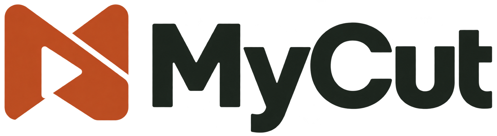
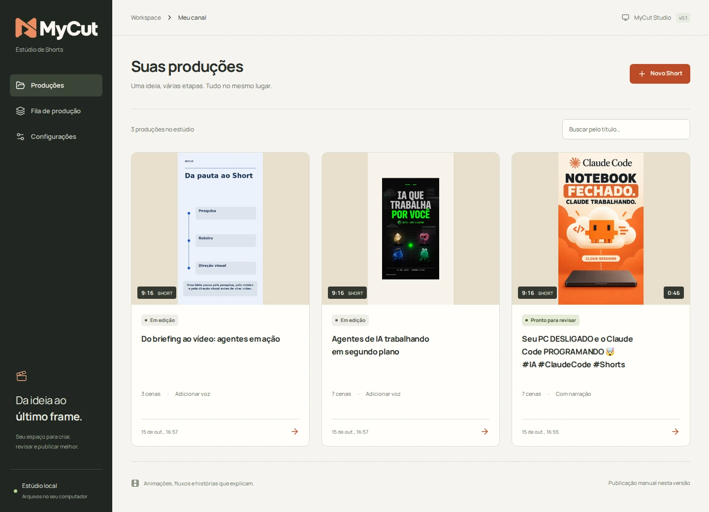
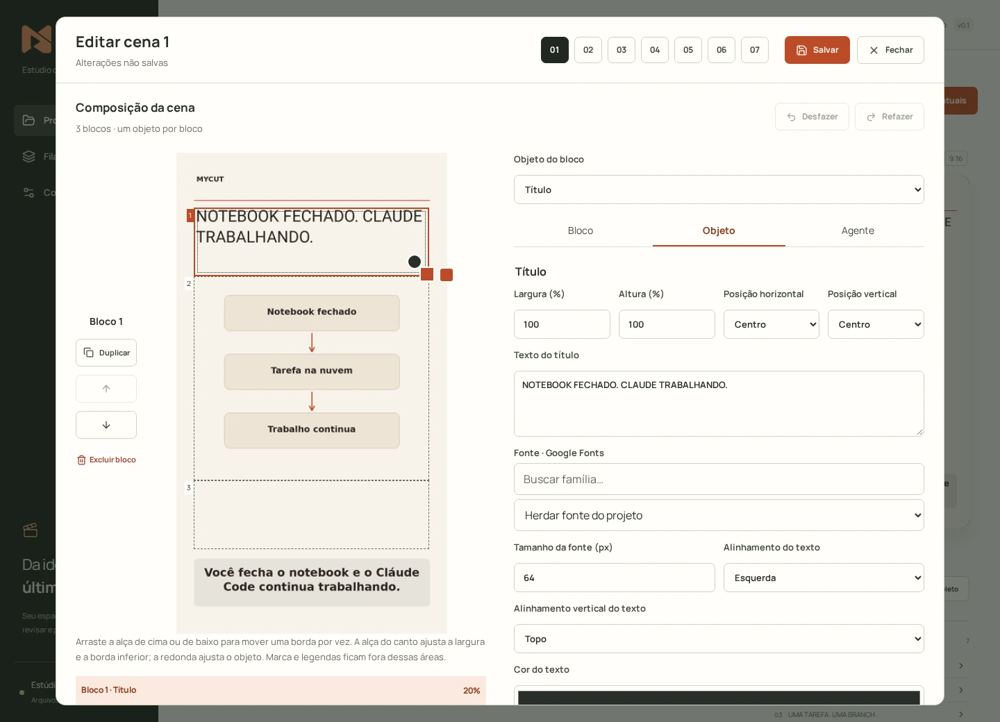
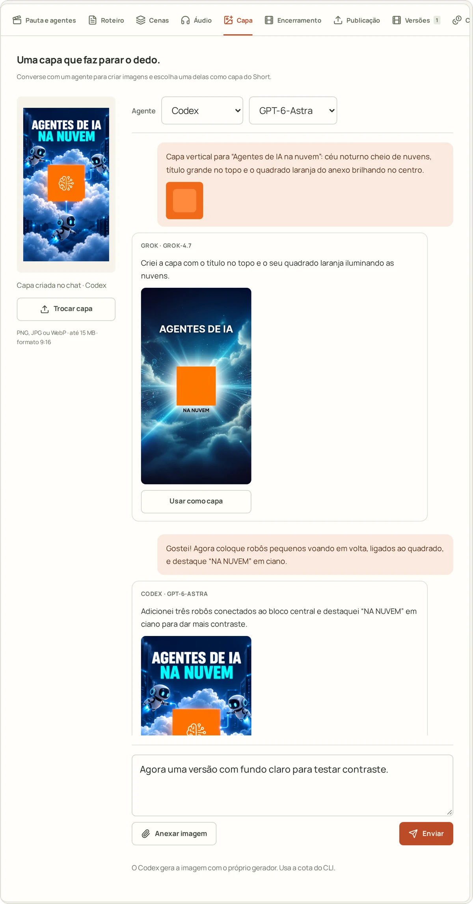
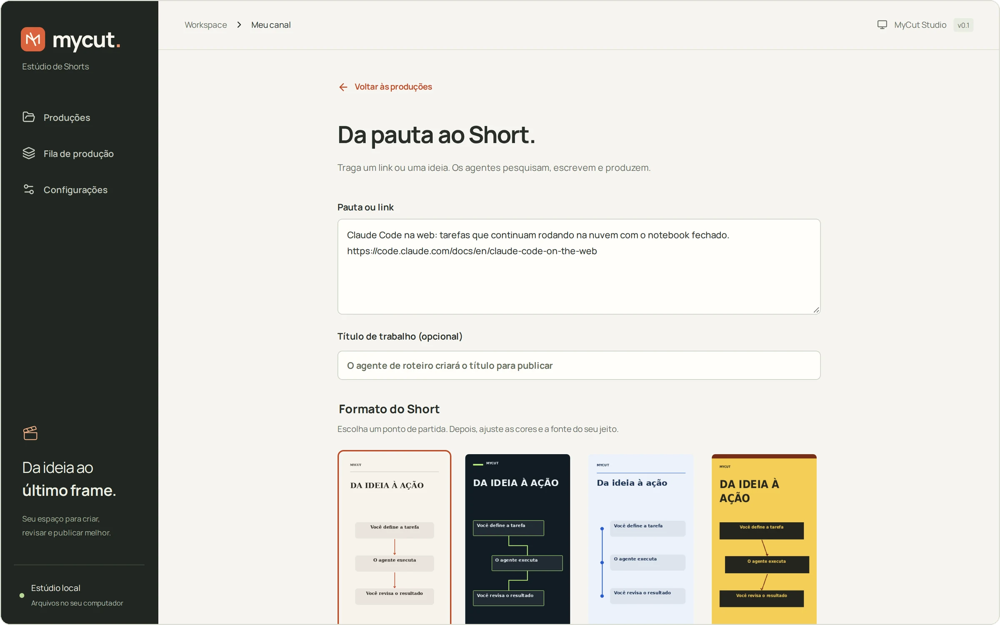
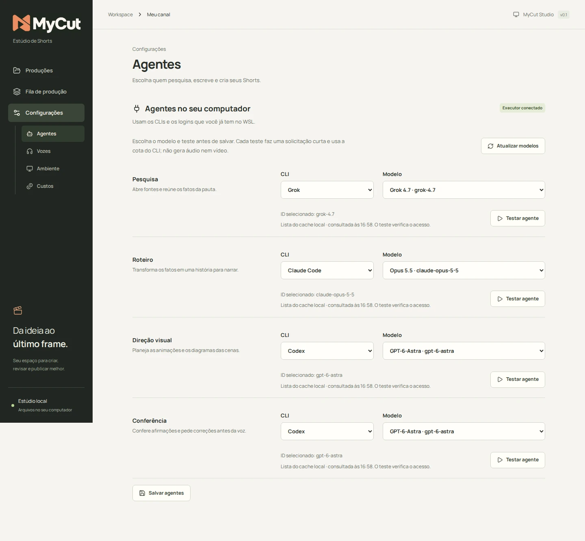
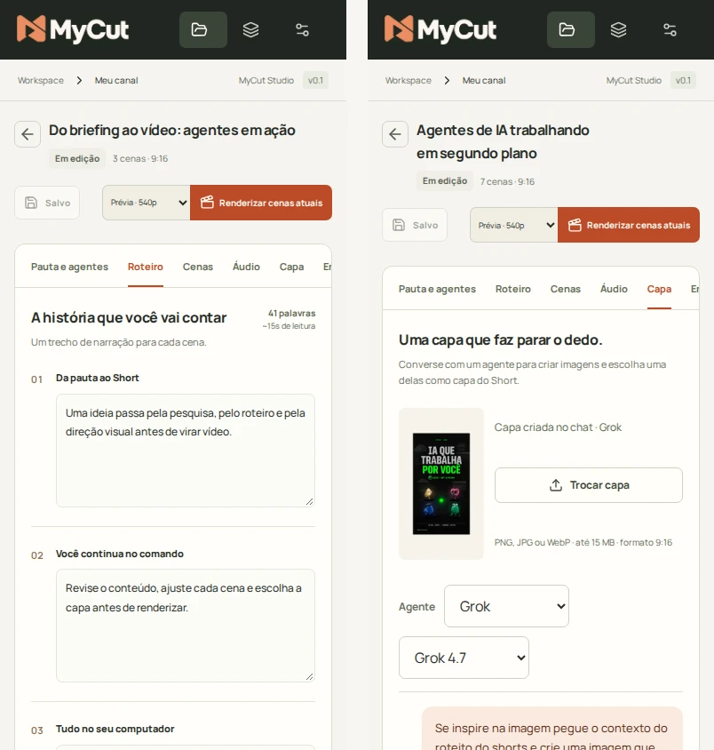

<div align="center">

<picture>
  <source media="(prefers-color-scheme: dark)" srcset="web/src/assets/brand/mycut-logo-dark.webp">
  <source media="(prefers-color-scheme: light)" srcset="web/src/assets/brand/mycut-logo.png">
  
</picture>

# MyCut

**Da pauta ao Short, com agentes de IA trabalhando no seu computador.**

Estúdio local para produzir Shorts sobre inteligência artificial em português brasileiro:<br>
pesquisa, roteiro, cenas animadas, narração, capa e vídeo final em 1080 × 1920.


[Começar](#começar) · [Editor de cenas](#editor-de-cenas) · [Como funciona](#como-funciona) · [Capa com agentes](#capa) · [Executar sem Docker](#executar-sem-docker) · [Verificação](#verificação)

<br>



</div>

<br>

O objetivo é automatizar a descoberta de pautas, a pesquisa, o roteiro, a voz, as imagens, a montagem e a publicação de **dois Shorts por dia** usando agentes de IA. O estúdio web local conecta **Codex CLI**, **Claude Code CLI** e **Grok CLI** para transformar uma pauta em roteiro, cenas, capa, narração ElevenLabs e vídeo.

> [!NOTE]
> A coleta recorrente de tendências, o calendário de duas produções diárias e a publicação automática no YouTube ainda precisam ser implementados. Continuam sendo parte do objetivo do produto.

## Em destaque

<table>
<tr>
<td width="50%" valign="top">

### Agentes que você já usa
Pesquisa, Roteiro, Direção visual, Conferência e Arte rodam nos CLIs autenticados no seu WSL. Escolha o CLI e o modelo de cada papel e teste antes de salvar.

</td>
<td width="50%" valign="top">

### Cenas editáveis em blocos
Combine títulos, parágrafos, imagens e vídeos. Ajuste dimensões, Google Fonts, alinhamento e recorte; converse com o agente sobre cada objeto. A prévia usa o mesmo renderizador do vídeo.

</td>
</tr>
<tr>
<td width="50%" valign="top">

### Capa em conversa
Um chat com Grok, Codex ou Claude Code gera imagens 9:16. Anexe referências, peça ajustes e escolha a melhor como capa.

</td>
<td width="50%" valign="top">

### Tudo fica na sua máquina
SQLite, arquivos e fila locais, sem login. Cada versão guarda vídeo, capa, legendas, roteiro e manifesto para baixar como pacote.

</td>
</tr>
</table>

## Editor de cenas

Na aba **Cenas**, clique em **Editar cena** para abrir o editor em um modal amplo.
Os botões **01, 02, 03…** permitem navegar sem fechar; **Salvar** grava as
alterações das cenas visitadas e mantém o editor aberto.

- **Blocos ajustáveis:** cada cena nova começa com três áreas, nas proporções
  20%, 60% e 20%. Adicione, duplique, reordene ou exclua blocos. Cada borda
  pode ser redimensionada separadamente, ajustando somente o vizinho imediato.
- **Texto com Google Fonts:** título e parágrafo têm fonte, tamanho, cor e
  alinhamento próprios, inclusive **Topo, Centro e Rodapé**. Dimensões e tamanho
  da fonte aceitam digitação direta, decimais e ajustes pelas setas.
- **Imagem e vídeo:** importe arquivos ou use a biblioteca da produção. Escolha
  entre mostrar inteiro e preencher com corte, aplique zoom de até **500%** e
  arraste a mídia com o mouse para escolher o enquadramento.
- **Edição com agentes:** marque um objeto para conversa, peça mudanças e
  revise a proposta antes de aceitar. O alcance pode ser objeto, bloco ou cena.
- **Controles organizados:** abas **Bloco**, **Objeto** e **Agente**, comandos
  junto à composição e **Desfazer/Refazer** durante a edição.

Cenas antigas continuam funcionando e são preparadas em blocos ao abrir o
editor; a conversão só substitui a composição ao salvar. Diagramas convertidos
viram imagens. Marca do canal e legendas mantêm suas áreas separadas.
Veja formatos aceitos, limites e funcionamento no [guia do editor](docs/editor-de-cenas.md).

O estúdio também ganhou cards de produção com capa, status, título, informações
e rodapé alinhados, além da identidade visual MyCut atualizada. A inicialização
local escolhe uma porta livre e pode acompanhar o WSL por serviço de usuário.

<p align="center">
  
  <br><sub><b>Editor de cenas</b> · ajuste a composição e navegue entre cenas no mesmo modal, com Salvar e Fechar sempre disponíveis.</sub>
</p>

<p align="center">
  
  <br><sub><b>Capa</b> · converse com o agente, anexe referências e escolha uma imagem como capa do Short.</sub>
</p>

<p align="center">
  
  <br><sub><b>Novo Short</b> · cole a pauta ou o link, escolha o formato e decida entre produzir o Short completo ou revisar o roteiro e as cenas primeiro.</sub>
</p>

<p align="center">
  
  <br><sub><b>Agentes</b> · um CLI e um modelo por papel, com teste curto antes de salvar.</sub>
</p>

<p align="center">
  
  <br><sub>A interface também funciona no celular.</sub>
</p>

<sub>Capturas atualizadas em 15/10/2026, com a interface atual e produções de demonstração em uma instância local isolada. O estado de conexão dos agentes é demonstrativo; a capa exibida no chat foi criada anteriormente pelo Grok.</sub>

## Começar

No Linux ou WSL, a partir da raiz do repositório, com Docker e Docker Compose disponíveis:

```bash
mkdir -p .data
bash scripts/docker.sh --build
```

Abra o endereço exibido ao iniciar, normalmente **http://127.0.0.1:8321**. Se a porta estiver ocupada ou reservada, o iniciador tenta 8322, 8323 e assim por diante, até 65535. Ele verifica Windows e Linux, confirma que o endereço responde pelo MyCut e salva a URL em `.data/http.json`. O endereço usa IPv4 explicitamente para evitar diferenças na resolução de `localhost` no Windows. A porta interna do container permanece 8321. Para os agentes funcionarem, ative o serviço local como explica [Conectar os agentes](#conectar-os-agentes-e-a-elevenlabs).

Para iniciar junto com o WSL e recuperar automaticamente conflitos posteriores:

```bash
python3 scripts/launch.py install
```

O serviço de usuário `mycut-app.service` verifica a aplicação a cada 30 segundos. Mantém a porta quando o MyCut já está acessível e procura outra quando necessário; aguarda a fila terminar antes de recriar containers em uso. Se o Docker Desktop ainda não estiver pronto, tenta novamente. O WSL e o Docker Desktop precisam estar em execução; este serviço não inicia o Windows nem mantém o WSL ligado por conta própria.

```bash
cat .data/http.json                         # endereço atual
systemctl --user status mycut-app.service
journalctl --user -u mycut-app.service -f
bash scripts/docker.sh --build              # atualizar a imagem e os containers
```

Use `scripts/docker.sh` para iniciar/atualizar com seleção automática. O comando direto `docker compose up` usa a porta padrão ou o valor de `MYCUT_PORT`, sem executar a busca. `MYCUT_PORT=9000 bash scripts/docker.sh` define o início da busca; uma instância já ativa conserva sua porta.

A primeira construção baixa as dependências. A API serve a interface compilada e o worker processa a fila em outro container. Fechar a aba não interrompe uma produção; os serviços e o computador precisam continuar ligados.

A navegação fica no endereço: `#/configuracoes/agentes`, `#/configuracoes/vozes`, `#/configuracoes/ambiente`, `#/fila`, `#/novo` e `#/producoes`. No editor, a URL também identifica a produção e a aba. Atualizar a página preserva essa localização; Voltar e Avançar acompanham a navegação. Links antigos `#/conexoes` e `#<id-da-produção>` continuam funcionando. Alterações não salvas no editor mantêm o aviso de descarte ao sair.

O arquivo `web/pnpm-workspace.yaml` autoriza o script de instalação do `esbuild` e é copiado antes de instalar as dependências na imagem. Essa configuração também vale para a instalação local; não é necessário executar `pnpm approve-builds` interativamente no container.

Para alinhar **áudios importados sem tempos de fala**, prepare o modelo local uma vez:

```bash
docker compose exec worker python -m mycut.download_model
```

Isso baixa o Whisper `large-v3` para o volume persistente `models`. Não há cobrança por chamada nem envio do áudio para uma API; o alinhamento roda na CPU. O primeiro Short pode reutilizar seu alinhamento já salvo quando o áudio é exatamente o mesmo. Prévias sem narração e vozes geradas pela integração ElevenLabs não precisam desse modelo: a integração recebe os tempos de fala do provedor.

```bash
docker compose logs -f api worker  # acompanhar serviços
systemctl --user stop mycut-app.service  # se o serviço automático estiver instalado
docker compose stop                # parar sem apagar projetos
```

A configuração atende somente o computador local, sem login. Não foi preparada para exposição pública. O bind de `.data` usa o usuário de ID 1000, padrão deste WSL; em outro sistema, o diretório precisa permitir escrita a esse usuário.

## Conectar os agentes e a ElevenLabs

Com os três CLIs instalados e autenticados no WSL, execute uma vez na raiz do MyCut, como seu usuário habitual e sem `sudo`:

```bash
python3 scripts/install-agents-service.py
```

O instalador cria o serviço de usuário `mycut-agents.service`, habilita a inicialização junto com o WSL e o inicia em segundo plano. O executor reinicia após uma saída inesperada; fechar o terminal não o encerra. Requer `systemd` habilitado no WSL e ativa `linger` para os serviços do usuário continuarem após o logout. A distribuição WSL e o Docker precisam estar ativos; o serviço acompanha a inicialização do WSL e não inicia o Windows ou a distribuição por conta própria. [Ciclo de vida de serviços no WSL](https://learn.microsoft.com/en-us/windows/wsl/systemd#how-does-enabling-systemd-affect-wsl-architecture).

O executor usa os logins locais dos CLIs, sem copiar credenciais para o Docker. API, worker e executor compartilham `.data`. O instalador registra `MYCUT_DATA_DIR`, os caminhos dos executáveis e as variáveis de localização dos perfis em `~/.config/mycut/agents.env` (ou no diretório definido por `XDG_CONFIG_HOME`), com permissão `0600`. Não copia chaves de API nem o ambiente completo do terminal. Caminhos temporários do gerenciador de Node são resolvidos para diretórios persistentes. Os comandos e perfis escolhidos no aplicativo continuam valendo.

```bash
systemctl --user status mycut-agents.service
journalctl --user -u mycut-agents.service -f
```

Antes de reiniciar ou parar, espere as produções, gerações de capa e testes de agentes terminarem. Após atualizar o código do MyCut, recarregue o executor com:

```bash
systemctl --user restart mycut-agents.service
```

Para desativar a inicialização automática e parar: `systemctl --user disable --now mycut-agents.service`. Para reativar: `systemctl --user enable --now mycut-agents.service`. O modo manual continua disponível com `bash scripts/agents.sh`, mantendo esse terminal aberto; use-o com o serviço parado. O instalador recusa a instalação se houver um executor ativo, sem interrompê-lo. Se mudar o caminho do projeto, a instalação do Node ou as variáveis dos perfis, espere a fila esvaziar, pare o serviço e execute o instalador novamente a partir do ambiente atualizado. Para apenas inspecionar os arquivos, use `python3 scripts/install-agents-service.py --output-dir .data/agents-service-preview`.

Se você usar `MYCUT_DATA_DIR` fora do Docker, todos os componentes precisam apontar para os mesmos dados. O serviço recupera a ponte permanente do WSL para continuar abrindo o Chrome do Windows mesmo sem um terminal.

Por padrão, o executor chama `codex`, `claude` e `grok`. Em **Configurações › Ambiente › Comandos dos CLIs**, você pode trocar o comando de cada um para usar outro perfil ou login. Por exemplo, `CLAUDE_CONFIG_DIR=~/.config/cloak/profiles/amjr/claude claude` ou `cloak exec --profile amjr claude`. Variáveis `NOME=valor` antes do executável, `~` e `$VAR` são expandidas no WSL. O comando roda sem shell, então aliases, funções e pipes não funcionam. O executor relê os comandos a cada chamada, sem reiniciar, e atualiza a lista de modelos depois de salvar. Esses comandos são executados no seu computador; a API aceita a alteração apenas da própria interface local.

1. No aplicativo, abra **Configurações › Agentes**. Distribua os CLIs entre Pesquisa, Roteiro, Direção visual, Conferência e Arte (só Codex ou Grok). Escolha o modelo na lista e clique **Testar agente** em cada papel. O teste usa a seleção atual sem salvá-la; clique **Salvar agentes** quando terminar. **Padrão do CLI** deixa a escolha a cargo do CLI.
2. Abra **Configurações › Vozes**. Na seção **ElevenLabs**, cole uma chave de API da sua conta e clique **Conectar ElevenLabs**. A chave precisa permitir listar vozes/modelos e gerar fala. Não coloque a chave no roteiro, Git ou chat. [Documentação de autenticação](https://elevenlabs.io/docs/api-reference/authentication).
3. Selecione a voz **Junior**, ou outra da sua conta, o modelo e os ajustes. Clique **Salvar voz**. A lista vem da conta conectada.
4. Em **Novo Short**, informe a **Pauta ou link**, escolha um formato e personalize fonte, fundo, texto e destaque. Defina se quer somente animações ou também imagens. Os agentes recebem essas escolhas antes de criar o roteiro e as cenas. Escolha **Produzir com agentes** ou, para conferir o roteiro antes de gastar voz, **Roteiro e cenas primeiro**.

<details>
<summary><strong>Navegador para a pesquisa (Chrome DevTools MCP)</strong></summary>

Alguns sites, como o `openai.com`, respondem 403 à leitura automática dos CLIs. Nesse caso, a etapa de Pesquisa pode abrir a página no Chrome do Windows, como uma pessoa faria. Isso vale para Claude Code, Codex e Grok. O executor abre o Chrome Canary (ou o Chrome) com a porta de depuração `9222` e um perfil próprio em `%LOCALAPPDATA%\MyCut\ChromeProfile`, sem os seus logins. Cada CLI recebe o [Chrome DevTools MCP](https://github.com/ChromeDevTools/chrome-devtools-mcp) com uma versão fixa e apenas as ferramentas de navegar, ler (snapshot), clicar, rolar e fechar abas. Formulários, digitação, uploads e execução de JavaScript ficam fora. O texto das páginas é tratado como dado, não como instrução.

Configure em **Configurações › Ambiente › Navegador para pesquisa**: ative ou desative, informe o caminho do `chrome.exe` se a detecção automática não achar, escolha a porta e use **Abrir e testar**. Requisitos: Node.js com `npx` no WSL e rede espelhada (`networkingMode=mirrored` no `.wslconfig`), para o WSL alcançar a porta do Chrome no Windows. Desde o Chrome 136, a depuração remota [não funciona no perfil padrão](https://developer.chrome.com/blog/remote-debugging-port), por isso o perfil é separado. Se um site exigir login, entre nele só nessa janela do MyCut.

Se o Chrome ou o MCP falharem, a pesquisa continua com a busca e a leitura dos próprios CLIs e registra a falta do navegador nas limitações. Sem fonte verificada, o fluxo continua parando antes do roteiro. No Grok, as execuções com navegador usam `--trust` na pasta temporária e desligam os MCPs importados do Claude e do Cursor. Nesse modo, chamar outro servidor MCP encerra a execução.

</details>

<details>
<summary><strong>Vozes ElevenLabs: amostras, filtro de idioma e testes</strong></summary>

Conectar/listar vozes não sintetiza áudio. Produzir a voz usa créditos da conta ElevenLabs. Não há repetição automática da requisição paga após erro. O texto completo vai em uma única requisição para preservar a continuidade da narração. Os [tempos de fala retornados pelo provedor](https://elevenlabs.io/docs/api-reference/text-to-speech/convert-with-timestamps) alimentam a sincronização de cenas e legendas. O MP3 de transporte fica como intermediário; a trilha usada no render é WAV normalizado.

Em **Configurações › Vozes**, o catálogo carrega automaticamente. Depois de conectar, a chave e a ação de desconectar ficam em **Gerenciar conexão**. **Ouvir amostra · grátis** reproduz o áudio pronto fornecido pela voz, quando disponível, sem gerar fala. Essa amostra não reflete o modelo ou os ajustes do formulário; uma voz sem amostra mostra a indisponibilidade, sem gerar áudio como alternativa. O campo [`preview_url`](https://elevenlabs.io/docs/api-reference/voices/search) vem do catálogo do provedor.

Antes de escolher a voz, use **Idioma da voz**. O filtro inicia em **Português**, mostra a quantidade de vozes por idioma e mantém sua preferência neste navegador após refresh. Há opções **Todos os idiomas** e **Idioma não informado**. A seleção usa o idioma cadastrado em `labels.language`, não a capacidade multilíngue do modelo; o nome da voz também mostra idioma e sotaque quando informados. Trocar o filtro não altera a voz padrão salva: uma seleção que fica fora dele precisa ser escolhida novamente para salvar ou gerar um teste. Filtrar não gera fala nem consome créditos.

**Testar com meu texto** aceita até 300 caracteres e usa a seleção atual, sem alterar a voz padrão salva nem criar uma produção. O botão **Gerar teste (usa créditos)** informa a cobrança antes do clique; não é uma prévia gratuita de texto personalizado. Os últimos cinco testes aparecem com texto, voz, modelo e ajustes e podem ser reouvidos após recarregar a página. Repetir texto, voz, modelo e ajustes reutiliza o MP3 local, sem nova geração. O cache fica em `.data/voice-tests/`, separado por chave conectada, e não é versionado. [Regras de consumo e limites das regenerações gratuitas no site](https://elevenlabs.io/docs/help-center/product/core-capabilities/text-to-speech/is-there-a-way-to-preview-audio-without-losing-quota-before-downloading).

</details>

<details>
<summary><strong>Testes de agente e catálogo de modelos</strong></summary>

A indicação “executor conectado” comprova o processo ativo e os executáveis disponíveis no PATH; não comprova login, saldo ou acesso a cada modelo. **Testar agente** executa uma solicitação curta pelo mesmo adaptador usado na produção, valida um desafio e mostra resposta, duração, ID solicitado e modelo informado nos metadados do CLI. O teste usa a cota do CLI; não gera voz ou vídeo. Há um teste por vez, cancelamento e limite de três minutos, incluindo espera na fila. O último resultado de cada papel permanece disponível após recarregar a página.

Claude e Grok podem informar `modelUsage`: o app distingue confirmação, modelo diferente e resolução do padrão. No adaptador Codex atual, a resposta pode ser validada, mas o modelo efetivamente usado **não é confirmado**. Uma declaração do próprio modelo nunca serve como confirmação de identidade.

Os seletores recebem IDs do cache local de modelos do Codex/Grok e da inicialização do Claude Code, sem copiar credenciais. O catálogo não comprova acesso nem login. **Atualizar modelos** relê essas fontes quando o executor está livre; se a lista faltar ou estiver antiga, abra o CLI no WSL antes de atualizar. Trocar de CLI limpa o modelo selecionado. Nomes antigos digitados à mão precisam ser selecionados novamente. Após atualizar o MyCut, espere a fila esvaziar, reconstrua os containers e execute `systemctl --user restart mycut-agents.service` para carregar o novo executor; no modo manual, encerre e execute novamente `bash scripts/agents.sh`.

</details>

## Como funciona

1. Pesquisa abre fontes e reúne fatos com referências. Se não conseguir verificar a pauta, o fluxo para.
2. Roteiro cria narração, título, descrição e tags. Direção visual cria cenas de animação/fluxo. A capa não faz parte deste fluxo: ela é criada à parte, na aba **Capa**.
3. Conferência compara as afirmações com a pesquisa. Pode pedir uma correção; se reprovar novamente, o fluxo para antes da voz.
4. ElevenLabs gera a narração usando a voz salva. Pillow/FFmpeg renderizam o Short em 1080 × 1920, com cenas animadas e legendas.
5. Você acompanha as etapas, assiste ao resultado e baixa vídeo, capa, legendas, roteiro, publicação e manifesto.

### Short livre

Em **Novo**, a opção **Livre** fica ao lado dos quatro formatos. O prompt é a especificação: uma ideia solta ou um roteiro completo em Markdown, com tabelas e blocos de código, até 40.000 caracteres. Imagens de referência (até 8) entram na biblioteca da produção; arquivos de texto e Markdown anexados são acrescentados ao prompt.

1. Roteiro lê o prompt primeiro. Num roteiro completo, narração, texto na tela e ordem dos trechos seguem o texto ao pé da letra, só com ajustes de grafia e pontuação. Numa ideia, o agente escreve com liberdade de estrutura. Ele também lista as afirmações factuais externas.
2. Pesquisa só roda se essa lista não estiver vazia, e só para esses itens. Afirmação não verificada vira aviso no roteiro do usuário, ou é suavizada no roteiro do agente; nunca recusa a produção, nem quando o CLI da pesquisa falha.
3. Direção visual compõe cenas e planos com blocos e fundos, sem o esqueleto 20/60/20. Após uma correção, problemas restantes são reparados (alturas, mídia inexistente, texto que não cabe, âncoras) em vez de falhar; texto encurtado para caber vira aviso.
4. Conferência verifica fatos e fidelidade ao prompt. Se reprovar também depois da correção, se falhar ou se a correção não puder ser feita, roteiro e cenas já pagos ficam salvos com os problemas como avisos, e a produção para antes da voz.
5. Arte gera as imagens das cenas, depois da conferência aprovar e antes da voz. O diretor tira do prompt a **bíblia visual** (tom, fichas de personagem e de cenário) e pede até 12 imagens, até 4 delas imagens-base (fichas e cenários vazios). As bases saem primeiro e são anexadas a cada imagem que as cita, para manter o rosto e o cenário. Em **Novo**, escolha **Conferir as imagens-base primeiro** (padrão), **Gerar todas as imagens** ou **Sem imagens geradas**.

Com **Conferir as imagens-base primeiro**, a produção para depois das bases, sem gerar voz. Na aba **Arte**, cada imagem aceita uma orientação, com até 4 imagens de exemplo, e é refeita seguindo-a; uma cena feita com a versão anterior de uma base fica marcada. **Gerar as imagens que faltam** produz o restante com as bases anexadas e, se a produção era o Short completo, segue para a voz e o vídeo. Cada imagem entra no plano que o diretor escolheu, sem tomar o lugar de algo que você editou. Uma imagem que falha vira aviso e o plano fica com o fundo do estilo. O papel Arte, em **Configurações › Agentes**, aceita só Codex ou Grok, porque o Claude Code não gera imagens. Antes de cada geração aparece a estimativa (imagens × preço por imagem, editável em **Configurações › Custos**), e o valor registrado fica na aba **Custos**; os CLIs não informam o custo das imagens, então o valor é só uma referência.

Sem formato de base, o diretor tira do tom do prompt o fundo, as cores, a fonte (Google Fonts) e a legenda: de 2 a 4 palavras por vez, palavras-chave na cor de destaque e posição sempre na área segura, fora dos 15% inferiores e da faixa direita dos botões do YouTube. O resumo aparece em **Estilo gerado**, na aba **Pauta e agentes**. Uma pausa pedida no roteiro, como “(pausa)”, vira silêncio real entre trechos da voz e adia as legendas e os planos seguintes; ela aparece na aba **Roteiro**. Se o prompt pede loop, o último quadro funde no primeiro, a menos que haja um vídeo de encerramento. O roteirista também entrega o pacote de publicação (opções de título, descrição, hashtags e comentário fixado), que fica na aba **Publicação** e no `publicacao.txt`.

Os avisos aparecem na aba **Pauta e agentes**. Personagens fictícios realistas e avatares são permitidos quando o contexto justifica; pessoas reais identificáveis continuam proibidas ([ADR 0005](docs/adr/0005-short-livre.md)).

A conferência automática é uma etapa editorial, não uma garantia de verdade. A revisão final continua disponível antes de publicar. O agente de direção usa cenas de fluxo, comparação e destaque; no modo com imagens, pode selecionar uma imagem pertinente da biblioteca ou das fontes verificadas. Nos quatro formatos, as cenas não usam ilustrações geradas por modelo de imagem; isso acontece no chat da capa e na Arte do Short livre.

O editor permanece para ajustar o material, importar voz (aba **Áudio**) ou capa (aba **Capa**), gerar apenas a narração ou renderizar novamente sem pagar por outra voz. Comparações têm dois lados. Limites de edição: 12 cenas, 500 palavras, áudio até 3 minutos e 100 MB; capa até 15 MB. A geração ElevenLabs aceita até 4.000 caracteres. O agente de roteiro trabalha com até 180 palavras e 3 a 8 cenas.

Nas produções que ainda usam os layouts anteriores, **Criar cenas com agentes** recupera cenas incompletas; quando preenchidas, a ação aparece como **Refazer cenas com agentes**. Ela salva os ajustes abertos, chama apenas Direção visual e Conferência e recria os diagramas, preservando o roteiro, o áudio e a capa. Usa a cota dos CLIs, sem gerar outra voz. Fluxos exigem de dois a quatro textos, comparações exatamente dois e destaques ao menos um; respostas vazias recebem uma tentativa automática de correção e não são publicadas se continuarem inválidas. Em produções com cenas em blocos, use a aba **Agente** do editor para revisar e aceitar propostas de alteração.

Projetos e fila persistem em SQLite. Cada tentativa tem diretório próprio; etapas concluídas salvam checkpoints no projeto, e o job atualiza sua revisão. Edições concorrentes ficam bloqueadas durante a produção. Após cancelamento, resultados atrasados não podem substituir novas alterações. Ao reiniciar o worker, jobs em execução ficam marcados como interrompidos e não são repetidos automaticamente.

“Roteiro do Claude Code” era uma cópia fixa das sete cenas do primeiro Short, não um agente. Essa opção saiu da criação. O primeiro Short continua disponível como produção existente; ele é importado do material local em `shorts/claude-cloud/`, que fica fora do Git.

### Formatos, cores e imagens

Escolha o visual em **Novo Short** ou **Pauta e agentes**. Os formatos alteram a composição e a animação, além da paleta:

| Formato | Composição |
| --- | --- |
| Editorial | Fundo claro, fonte serifada e blocos com entrada suave. |
| Radar tech | Fundo escuro, etapas alternadas e entradas laterais. |
| Passo a passo | Guia lateral e etapas reveladas em sequência. |
| Impacto | Tipografia maior, blocos contrastantes e entrada com escala. |

Nos layouts anteriores, você pode trocar a fonte entre sem serifa, serifada, monoespaçada e condensada. Nos objetos de texto dos blocos, escolha uma família **Google Fonts** ou herde a fonte definida para os blocos da produção. Também é possível ajustar cores de fundo, texto e destaque e restaurar os valores do formato. As miniaturas e a prévia da cena usam o mesmo renderizador do vídeo. Essas escolhas pertencem à produção e ficam registradas em cada versão. Projetos antigos mantêm o visual anterior até você escolher um formato.

Em **Personalizar aparência › Nome do canal no vídeo**, substitua “MYCUT” pelo nome ou @ do seu canal (até 40 caracteres). Deixe vazio para ocultar o texto. A escolha permanece ao trocar ou restaurar um formato e aparece nas cenas e nas capas geradas ao renderizar novamente; capas importadas não são alteradas.

**Somente animações** impede o uso automático de imagens. Em **Animações e imagens**, escolha a origem: fontes da pauta, imagens importadas na biblioteca da produção ou ambas. O agente de pesquisa pode sugerir até três imagens de páginas verificadas. O MyCut baixa imagens HTTPS públicas e registra sua origem. Se nenhuma imagem elegível estiver disponível, as cenas usam animações; os avisos aparecem no editor. A origem limita a seleção automática, sem apagar imagens já armazenadas nem substituir suas escolhas manuais.

Nos layouts anteriores, selecione uma imagem por cena ou mantenha a animação. No editor de blocos, cada bloco pode receber uma imagem ou vídeo da biblioteca. Imagens aceitam PNG, JPG ou WebP de até 15 MB, com limite de 24 imagens por produção; vídeos aceitam MP4, MOV ou WebM de até 100 MB e 180 segundos. O enquadramento oferece imagem inteira ou preenchimento com corte, zoom e reposicionamento pelo mouse. Para usar sua biblioteca antes dos agentes, crie a produção sem iniciar a geração e importe os arquivos. Refazer os layouts anteriores reutiliza a pesquisa existente; uma nova busca de imagens acontece na produção completa.

Após mudar o visual, **Renderizar cenas atuais** aplica as alterações reutilizando a narração existente. Capas importadas ou criadas no chat permanecem como estão; capas compostas pelo antigo agente de direção seguem o visual atual.

### Encerramento

Na aba **Encerramento**, importe um MP4, MOV ou WebM de até 100 MB e 60 segundos, ou escolha um vídeo da biblioteca compartilhada entre as produções. A prévia da aba reproduz somente o encerramento. O vídeo preserva a imagem inteira no formato vertical e usa seu próprio áudio, quando houver.

Marque **Incluir no final deste Short** para acrescentá-lo após a última cena. A inclusão começa desativada, para que cada produção receba o clipe somente após sua escolha; importar um vídeo o disponibiliza na biblioteca. Desmarcar mantém o arquivo para uso posterior. Clique em **Salvar alterações** para guardar a escolha ou em **Renderizar cenas atuais** para salvar e gerar o Short com ela, reutilizando a narração existente. O vídeo já renderizado permanece como estava até a nova renderização. Cenas e encerramento juntos devem ter no máximo 180 segundos; se ultrapassarem, encurte as cenas ou desative a inclusão.

### Capa

A aba **Capa** é um chat: descreva a capa, anexe até 4 imagens de referência (PNG, JPG ou WebP, até 15 MB cada) e escolha o agente e o modelo no topo do chat. Cada mensagem gera uma imagem 9:16, e o pedido seguinte recebe a conversa e a última imagem, para ajustes como “deixe o fundo mais escuro”. A imagem só vira capa quando você clica em **Usar como capa**. Também é possível importar uma capa pronta.

- **Grok** usa `image_gen`/`image_edit` e **Codex** usa a geração de imagens do próprio CLI; os CLIs recebem somente essas ferramentas.
- **Claude Code** não tem gerador de imagens: desenha a capa em SVG (formas, gradientes, texto e os anexos), que o MyCut converte em PNG com `resvg`. O SVG não pode usar scripts nem referenciar arquivos além dos anexos.

O chat roda numa fila própria do worker: gerar uma imagem não bloqueia a edição nem uma produção em andamento, e há uma geração por vez por produção. O custo aparece em **Custos** como versão “Capa”. Depois de atualizar o MyCut, espere a fila esvaziar e reinicie o serviço dos agentes, porque o executor troca anexos e imagens com os CLIs. Alterar formato ou cores não solicita uma nova voz nem consome créditos ElevenLabs.

## Executar sem Docker

Requisitos: Node.js 24+, pnpm 12.8.1, Python 3.12, `uv`, FFmpeg/ffprobe e fontes DejaVu. No Ubuntu:

```bash
sudo apt-get update
sudo apt-get install ffmpeg fonts-dejavu-core fonts-dejavu-extra
uv venv --python 3.12 .venv-app
uv pip install --python .venv-app/bin/python -r backend/requirements.txt
pnpm --dir web install --frozen-lockfile
npm --prefix web run build
bash scripts/start.sh
```

O modelo Whisper só é necessário para alinhar áudio importado sem tempos de fala. Para baixá-lo: `PYTHONPATH=backend .venv-app/bin/python -m mycut.download_model`. O serviço dos agentes também funciona com API e worker locais; alternativamente, rode `bash scripts/agents.sh` em outro terminal, com o serviço parado. `scripts/start.sh` escolhe uma porta livre, inicia API e worker e encerra ambos com Ctrl+C. Pare o serviço `mycut-app.service` e os containers antes de usar os mesmos dados no modo local. Para reutilizar outro ambiente Python compatível, informe `MYCUT_PYTHON=/caminho/absoluto/bin/python`.

Durante o desenvolvimento, mantenha os serviços acima ativos e rode `pnpm --dir web dev` em outro terminal. Abra http://localhost:5173; o Vite lê `.data/http.json` ao iniciar para encaminhar `/api` à porta escolhida. Reinicie o Vite se a API mudar de porta, ou informe `MYCUT_PORT` explicitamente. A porta do servidor de desenvolvimento continua sendo 5173.

| Variável | Padrão | Uso |
| --- | --- | --- |
| `MYCUT_DATA_DIR` | `.data` na raiz | Banco, uploads e versões |
| `MYCUT_PORT` | `8321` | Primeira porta a tentar nos iniciadores; porta efetiva passada à API |
| `MYCUT_WHISPER_MODEL` | `large-v3` | Modelo do faster-whisper |
| `MYCUT_WHISPER_DIR` | não definido | Caminho para um modelo local já baixado |
| `MYCUT_WEB_DIR` | `web/dist` | Interface compilada |
| `MYCUT_SEED` | `1` | Use `0` para iniciar sem importar o exemplo |

Para backup, pare os serviços e copie `.data` inteira. Os áudios originais em `audios/` e o material de `shorts/` ficam fora do Git; preserve-os também.

## Verificação

O [editor de cenas em blocos](docs/editor-de-cenas.md) permite compor título,
parágrafo, imagem, vídeo e Fluxo animado, usar Google Fonts e revisar propostas
dos agentes antes de aplicá-las. O guia descreve a conversão de cenas anteriores e os
testes específicos dessa funcionalidade.

```bash
uv pip install --python .venv-app/bin/python -r backend/requirements-test.txt
PYTHONPATH=backend .venv-app/bin/python -m unittest discover -s backend/tests -v
python3 -m unittest discover -s scripts -p 'test_ports.py' -v
npm --prefix web run build
npm --prefix web run test:navigation
docker compose config --quiet
```

Testes de navegador usam dados temporários e API/worker reais. Com a porta 8321 livre e a interface compilada:

```bash
pnpm --dir web exec playwright install chromium
npm --prefix web run test:e2e
```

O cenário cobre criação, salvamento, proteção de texto não salvo, comparação, atualização entre abas, exportação real e download em desktop e celular. Screenshots e traces ficam em `web/test-results/`.

Na validação de 15/10/2026, passaram **105 testes do backend**, **14 testes dos scripts de inicialização** e **9 testes de navegação** com histórico controlado, além do TypeScript e build Vite. Os testes cobrem persistência, limites de edição, propostas com agentes simulados e renderização real com FFmpeg.

Na rodada do Short livre (MYC-4, 16/10/2026), passaram **146 testes do backend**, os 10 testes dos scripts de inicialização, os testes de navegação, o TypeScript e o build Vite, além de 14 cenários de navegador em desktop e celular (Livre, formatos e estúdio). Os agentes foram simulados; essa rodada não comprova roteiro, pesquisa ou direção reais nos CLIs.

Na rodada de estilo gerado, legendas, pausas, loop e pacote de publicação (MYC-5, 16/10/2026), passaram **154 testes do backend**, os testes dos scripts de inicialização, os testes de navegação, o TypeScript e o build Vite, além de 80 cenários de navegador em desktop e celular. Os dois cenários de edição de preços (`costs.spec.ts`) já falhavam antes desta rodada, com o mesmo erro de seletor. Agentes e ElevenLabs foram simulados; a paridade prévia × MP4 das legendas e do loop foi verificada por pixels com FFmpeg real.

Também passaram **38 cenários de navegador** em desktop e celular, cobrindo edição em blocos, fontes, mídia, recorte, navegação, propostas, renderização e download. Dezesseis casos foram repetidos após uma interrupção da API temporária de testes; a repetição passou integralmente.

Em validações anteriores, o estúdio também foi executado com a narração escolhida do Short original, de 45,87 segundos. A leitura real dos três catálogos foi conferida; chamadas de inferência naquela rodada falharam por permissões locais (Codex/Grok) e sessão OAuth expirada sem renovação (Claude). Esses resultados não comprovam geração real nos provedores nem na ElevenLabs.

Na atualização de navegação, Docker build/up concluíram, os containers foram recriados e a API serviu o novo JavaScript. Na rodada das amostras de voz, **seis casos de navegador passaram em desktop/mobile**, usando o bundle real e respostas de API simuladas, sem consumir créditos. As capturas dessa tela foram inspecionadas. Isso não qualifica a síntese real nem substitui os casos de navegador das funcionalidades anteriores, que ficaram bloqueados naquela rodada. Consulte [a evidência e seus limites](docs/verificacao-studio.md).

## Direção editorial e visual

- Explicar notícias, modelos e ferramentas de IA com um ângulo próprio para o público brasileiro.
- Verificar as informações em fontes originais e manter as referências junto ao roteiro.
- Usar animações, fluxos e ilustrações que expliquem a narração, sem pessoas realistas geradas por IA.
- Revisar pronúncia, naturalidade, legibilidade e sincronização antes de publicar.

O Short do Claude Code usa creme, laranja e terracota, com a marca e o mascote na capa. A paleta acompanha esse assunto; não define a identidade de todas as produções futuras.

## Estrutura

```text
backend/mycut/                 API, armazenamento, mídia, renderização e worker
backend/tests/                 Integração ASGI, SQLite e exportação com FFmpeg
web/                           React, Vite, TypeScript e testes Playwright
scripts/start.sh               API + worker locais
scripts/docker.sh              Containers com seleção automática de porta
scripts/launch.py              Iniciador e instalação do serviço mycut-app
scripts/ports.py               Verificação de portas e acesso Windows/WSL
scripts/agents.sh              Executor dos CLIs autenticados no WSL
scripts/install-agents-service.py  Instalação do executor como serviço automático do usuário
compose.yaml                   API + worker em containers
.data/                         Dados pessoais do app (ignorado pelo Git)
```

## Arquivos versionados e arquivos locais

O Git inclui código, documentação e a identidade visual do MyCut em `assets/brand/`. O material de cada Short (`shorts/`), os experimentos de voz (`experiments/`) e as gravações (`audios/`) ficam só no computador.

O `.gitignore` exclui gravações pessoais, perfis de voz, resultados de experimentos, vídeos, áudios, renders derivados, versões antigas, caches, pesos de modelos, ambientes virtuais, credenciais e configurações locais. Esses arquivos continuam no computador; ignorá-los não os apaga.

## Próximas etapas

1. Qualificar os provedores com os logins/voz reais e ampliar a direção visual para ilustrações e logos quando necessários.
2. Integrar coleta recorrente de tendências, upload e agendamento no canal.
3. Automatizar duas produções diárias, com retomada após falhas e acompanhamento de desempenho.
