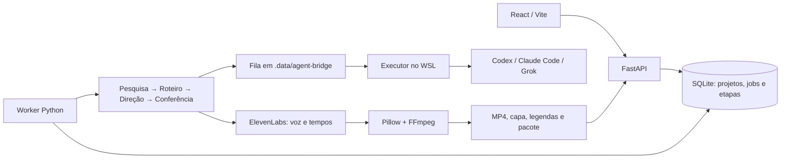

# Arquitetura do estúdio

O MyCut usa React/Vite, FastAPI e um worker Python sequencial. API e worker rodam no Docker; os CLIs autenticados ficam no WSL, ligados por uma fila local em arquivos. Não há API de LLM obrigatória para pesquisa/roteiro/direção/conferência.



## Módulos e fronteiras

- `store.py`: SQLite WAL, controle de revisão, um job ativo por projeto, entrada inicial imutável em `job_inputs`, checkpoints e etapas. Configurações públicas ficam no snapshot; a chave ElevenLabs nunca entra nele.
- `api.py`: projetos, fila, uploads, conexões e exports. Retorna indicação de chave conectada, nunca o segredo. Catálogo de vozes/modelos vem da conta real.
- `integrations.py`: configurações persistidas atomicamente em `.data/private/integrations.json`, arquivo 0600 e diretório 0700. Segredos locais não são criptografados em disco; o backup completo de `.data` os contém.
- `bridge.py` e `agent_runner.py`: solicitações JSON com prazo, lease e resposta atômica. O executor usa diretório temporário, sem shell para montar comandos, ferramentas restritas à pesquisa quando solicitada e sem autoaprovação ampla. Os logins continuam no host. CLI disponível não implica autenticação válida.
- `pipeline.py`: contratos Pydantic para pesquisa, roteiro, direção e conferência. Falha fechada para pesquisa inacessível, esquema inválido ou revisão reprovada duas vezes. Salva artefatos editoriais por tentativa. A capa é renderizada geometricamente a partir do conceito do agente.
- `elevenlabs.py`: catálogo e uma chamada de síntese com timestamps, sem retry pago automático. Valida áudio, normaliza volume e converte tempos de caracteres em palavras. Cenas e legendas reutilizam esse alinhamento por hash.
- `production.py`: render compartilhado entre editor e pipeline. Para áudio importado, usa alinhamento existente ou Whisper CPU local. Gera vídeos sem pessoas realistas.
- `worker.py`: lock exclusivo, heartbeat, subprocesso/grupo por job, cancelamento e recuperação. `plan` gera roteiro/cenas/capa; `voice` gera voz; `pipeline` faz tudo até render; `render` reaproveita materiais atuais.
- `seed.py`: preserva o primeiro Short como projeto existente. O template antigo continua aceito pela API por compatibilidade, mas foi removido da criação na interface.

## Dados e falhas

```text
.data/
  studio.sqlite3
  private/integrations.json
  agent-bridge/
    heartbeat.json
    requests/<id>/request.json, response.json, lease, cli.log, cli-error.log
  projects/<id>/
    uploads/
    renders/<job-id>/
      agents/<role>-<attempt>.json
      generated-cover.png
      voice/elevenlabs.mp3, narracao.wav, alignment.json
      short.mp4, capa.png, legendas.srt, roteiro.txt, publicacao.txt
      render-manifest.json, result.json, worker.log
```

O job captura a revisão inicial em uma tabela imutável separada e recebe apenas seus próprios checkpoints no snapshot de trabalho. A entrada anterior pode ser baixada como JSON sem configurações ou segredos, e os materiais de cada tentativa ficam disponíveis na aba Versões, inclusive planos e vozes sem vídeo. Cada checkpoint exige job ainda em execução e revisão correspondente; atualiza projeto e snapshot na mesma transação. Assim, roteiro e voz concluídos sobrevivem a uma falha posterior, sem permitir que uma resposta tardia sobrescreva uma edição feita após cancelamento. Saídas de vídeo só são servidas como concluídas quando o job termina com sucesso.

O worker marca execuções interrompidas como falhas na reinicialização; enfileiradas sobrevivem. O executor não repete solicitações já iniciadas sem resposta após reinício. Cancelamento ou perda do lease encerra o subprocesso CLI. Se uma chamada de voz já chegou à ElevenLabs, cancelar localmente não garante estorno dos créditos.

A porta 8321 é local, sem autenticação multiusuário. O Compose compartilha `.data`, monta o Short original como somente leitura e usa volume separado de modelos. O executor precisa usar o mesmo diretório e usuário com permissão de escrita. A máquina e os três processos precisam permanecer ativos. Coleta recorrente e publicação YouTube ainda não fazem parte do runtime.

## Contratos externos consultados

- [ElevenLabs: síntese com timestamps](https://elevenlabs.io/docs/api-reference/text-to-speech/convert-with-timestamps), [vozes](https://elevenlabs.io/docs/api-reference/voices/search), [modelos](https://elevenlabs.io/docs/api-reference/models/list).
- [Claude Code: execução sem interface](https://code.claude.com/docs/en/headless).
- [Grok CLI: scripts](https://docs.x.ai/build/cli/headless-scripting) e [permissões](https://docs.x.ai/build/features/permissions).
- Codex: contrato conferido no `codex exec --help` e `codex features list` instalados nesta máquina. Os CLIs evoluem; login e compatibilidade real precisam ser qualificados no host.
