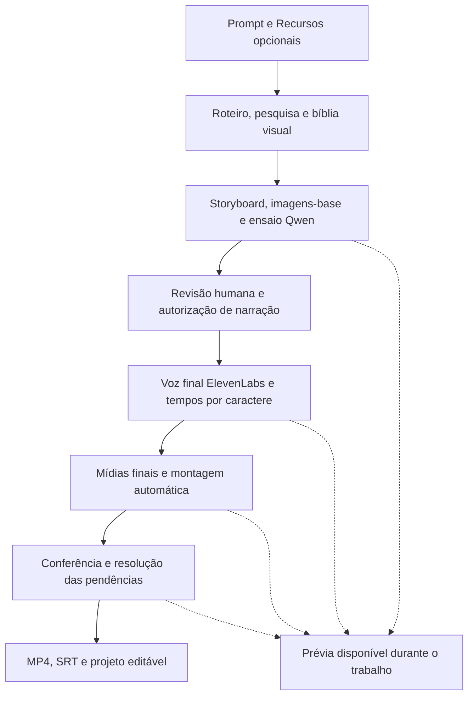
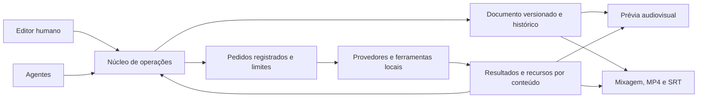

# Produção automática de vídeos horizontais

Status: Q1–Q50 respondidas; consolidação em 2026-10-17, aguardando confirmação
final de entendimento. Entrevista iniciada em 2026-10-16. Este documento registra
decisões e evidências; não autoriza implementação. A confirmação do entendimento
também se limita ao planejamento.

O [plano consolidado](plano-implementacao-video-horizontal.md) organiza os contratos,
as fases futuras e os critérios de aceitação. Este arquivo preserva a entrevista
e o levantamento que fundamentaram o desenho.

## Direção confirmada pelo usuário

- Criar vídeos horizontais para o YouTube, inicialmente para canais darks, com
  histórias e narração gerada por IA.
- Partir de um prompt e de recursos opcionais fornecidos pelo usuário. Os agentes
  devem planejar, pesquisar, produzir e editar, com o mínimo de intervenção humana.
- A produção visual pode ser automática. A geração paga da narração exige
  autorização humana: o autor avalia o texto e escolhe quando liberar o gasto.
- A primeira entrega é um storyboard com fala, textos na tela, tempos estimados
  e esboços de mídia. Enquanto a voz final aguarda autorização, ficam disponíveis
  storyboard, áudio local de teste e imagens-base da bíblia visual. A Q24 permite
  gerar essas bases antecipadamente para revisar a aparência; a voz final e o
  ajuste dos tempos continuam antecedendo as mídias finais de cada cena.
- O áudio de ensaio será local, com Qwen TTS e referência da voz Junior da
  ElevenLabs em PT-BR. O áudio final da narração será sempre da API da ElevenLabs,
  com autorização antes do gasto; Qwen será usado apenas nos testes.
- A geração de áudio será reaproveitável por trechos, refazendo os alterados e
  os vizinhos necessários para manter a entonação, com alcance e custo estimado
  apresentados antes da autorização da ElevenLabs.
- Cada trecho de fala pertence inteiro a uma cena e pode ser juntado ou dividido
  pelo humano. A ElevenLabs sempre é solicitada com tempos por caractere para
  alinhar textos, legendas e mídias; usar contexto vizinho e encadeamento quando
  disponíveis. Na prévia, um trecho em ensaio usa a duração do Qwen.
- Os áudios são guardados por texto, voz e configurações. Ao desfazer uma alteração
  e voltar à combinação anterior, o áudio válido da API é reutilizado sem geração.
  A montagem acompanha o áudio vigente pela regra da Q26.
- A autorização vale para um único pedido, com o custo apresentado, vinculada
  ao texto exato, voz, modelo, configurações e dicionário de pronúncia. Pontuação
  e grafia também contam como mudanças. Tentativas ou falhas que ultrapassem o
  valor estimado exigem nova autorização; mudanças só visuais não pedem nova voz.
- Esse pedido pode ser um lote de trechos executado em várias chamadas. A
  autorização não vale para lotes futuros; uma falha individual não revoga os
  demais trechos. Se o consumo real ultrapassar o apresentado, novos envios do
  lote param para nova autorização.
- A geração automática de clipes de vídeo por IA integra a primeira versão,
  junto com imagens geradas, movimentos, composição e mídia fornecida pelo usuário.
- Para os clipes, usar ferramentas locais conectadas a Grok/Gemini pela internet,
  com os acessos existentes; se não for possível, entregar o prompt pronto para
  geração manual na plataforma e importação do clipe em Recursos.
- Cada pedido de clipe fica vinculado à timeline com prompt, referências, duração
  desejada e proporção. A importação pelo pedido adiciona o arquivo a Recursos
  e preenche o esboço correspondente.
- A prévia pode ser gerada a qualquer momento; a exportação do vídeo finalizado
  ocorre somente ao final, com mídias resolvidas e narração final da API.
- O storyboard evolui para a montagem final no mesmo projeto editável.
- Pedidos explícitos de correção são aplicados diretamente no alcance solicitado,
  com desfazer; sugestões espontâneas continuam como propostas. Uma nova geração
  paga de narração continua exigindo autorização humana.
- O humano pode editar durante a produção. Pedidos ainda não enviados são
  atualizados se suas dependências mudarem, respeitando autorizações de gasto.
  Pedidos em andamento terminam; resultados conflitantes ficam como proposta.
- Todo pedido pago ou com cota fica registrado antes do envio. A retomada consulta
  o provedor e recupera resultados antes de pedir decisão sobre uma dúvida restante.
  Projeto, progresso, resultados, autorizações e consumo são salvos; o consumo é
  acompanhado por provedor e produção.
- O limite visual por qualidade é uma tentativa inicial e duas novas, ampliável
  explicitamente pelo humano para uma mídia. Falhas técnicas confirmadas sem
  resultado têm três tentativas totais com intervalos crescentes. Retomadas não
  zeram os contadores. Tetos configuráveis usam a unidade do provedor: caracteres
  ou créditos na ElevenLabs, gerações no Grok/Gemini. A interface mostra consumo
  versus teto; alcançar um teto para apenas os envios do provedor afetado.
- Pausar a produção impede novos envios, mantendo edição e prévia. Pedidos já
  enviados são acompanhados e seus resultados guardados. O serviço pode continuar
  com a janela fechada e deve notificar quando depender do humano. Ao desligar o
  computador, o serviço para e a retomada segue a recuperação da Q31.
- As pendências ficam numa central persistente no MyCut. Uma ponte no Windows
  deverá emitir notificações com a janela fechada a partir do serviço no WSL;
  notificação de navegador sozinha não satisfaz esse requisito. Notificar uma vez
  por pendência nova e agrupar as simultâneas por produção; qualificar na prova técnica.
- O primeiro teste completo será uma história original narrada, com personagens
  e cenários consistentes e composição livre, do storyboard até o vídeo final.
- A faixa prioritária é de 10–25 minutos, com duração desejada informada por
  produção. Isso orienta a validação; não estabelece um limite rígido.
- Cenas são unidades de sentido e podem conter várias mídias, falas, textos,
  cortes e pausas, sem divisão obrigatória a cada frase ou troca de imagem.
- Uma ideia pode ser desenvolvida livremente pelo agente; um roteiro completo
  preserva a fala e a ordem fornecidas, com reescritas apresentadas como sugestões.
- Ajustes humanos ficam preservados mesmo em pedidos amplos; o autor pode
  autorizar explicitamente sua substituição, mantendo desfazer.
- O editor mínimo permite editar fala/textos, trocar mídias, cortar/dividir/mover
  trechos, ajustar duração, posição, tamanho, sobreposição, volumes e transições,
  além de desfazer/refazer. Inclui velocidade do clipe, congelamento de quadro e
  os efeitos detalhados na Q22; máscaras, chroma key e LUTs ficam fora por enquanto.
- Música e efeitos vêm de Recursos ou de biblioteca com licença conhecida.
  Downloads da internet e serviços pagos dependem de autorização do usuário.
  A música diminui durante a fala; o áudio dos clipes fica desligado por padrão.
  A narração final é da ElevenLabs. Medir no arquivo final −14 LUFS integrado,
  ±1 LU, pico verdadeiro de no máximo −1 dBTP e 48 kHz. Normalizar em duas passagens,
  aplicando em modo linear; música começa ajustável em 15–20 LU abaixo da voz
  durante a fala. Confirmar o modo efetivamente aplicado, sem fallback dinâmico oculto.
- A bíblia visual reúne fichas de personagem, cenário e estilo. A conferência
  aponta mudanças indevidas de rosto, roupa, lugar ou estilo e propõe regenerar,
  sem substituir sozinha uma mídia ajustada pelo humano.
- Uma mudança de sentido revisa mídias e fontes relacionadas, mesmo sem alterar
  a duração. Mídias do agente sem ajustes humanos podem ser refeitas dentro dos
  limites; as ajustadas geram proposta ou pendência. Fichas e imagens-base afetadas
  também entram na revisão. Correções sem mudança de sentido não disparam essa
  revisão; a autorização de voz continua sensível à grafia e à pontuação.
- Afirmações sobre fatos reais são verificadas mesmo em histórias fictícias.
  As fontes ficam vinculadas aos trechos do roteiro, sem aparecer no vídeo.
  Afirmações não verificadas permitem prévia; antes da exportação, o autor precisa
  corrigi-las ou marcar "ciente", o que não equivale a verificá-las.
- Alterar a fala exige reavaliar a sequência, pois pode modificar sua sincronização.
- A montagem ajusta a duração da cena, desloca as seguintes e realinha o que depende
  da fala, sem deixar buracos quando ela cresce ou encurta. O agente tenta adaptar
  ou complementar as mídias antes de declarar pendência. Música entre cenas não
  estica: continua ou é cortada com fade. Ajustes humanos permanecem protegidos.
- Dar liberdade de estrutura e composição, sem impor templates narrativos ou visuais.
- Entregar a produção em um editor com os componentes editáveis, camadas e efeitos,
  para o humano corrigir trechos que ficaram ruins ou não agradaram.
- Concentrar o editor nessas correções, sem buscar a abrangência de um novo CapCut.
- Humano e agentes editam por operações aplicadas pelo mesmo núcleo, com histórico,
  desfazer/refazer, proteção humana e concorrência. Nenhum agente escreve direto
  no documento; cada item guarda a autoria da última alteração e o formato possui
  versão de esquema para migrações.
- Originais, áudio e versões são guardados por conteúdo/hash, compartilhados entre
  projetos sem duplicar o mesmo arquivo. Dados dos projetos e mídias ficam fora
  do Git, pois o repositório é público. A interface mostra espaço por projeto e a
  limpeza depende de escolha explícita do humano.
- Permitir que o editor, depois de pronto, também seja aproveitado pelos shorts.
- O editor atual de Shorts fica intocado até o núcleo novo passar pelo piloto
  horizontal. A conversão dos projetos antigos será opcional, projeto a projeto,
  e nunca sobrescreverá o original.
- Proporção e resolução são propriedades do projeto desde o início. O piloto usa
  1920×1080, 30 fps, MP4 H.264/AAC a 48 kHz e prévia em 720p ou menos; o modelo deve
  comportar 1080×1920 para Shorts, sem fixar 16:9.
- Legenda gravada na imagem é opcional e desligada por padrão, ativável pelo
  projeto ou prompt. A exportação final sempre entrega SRT da narração junto ao MP4.
- O alinhador local atende ao Qwen e à voz da API quando recuperar os tempos não
  resolver. Registrar origem API/histórico/local; baixa confiança gera pendência
  antes de exportar, sem nova voz paga automática. Recortes de voz usam alinhamento,
  pausas/fins de frase e transição curta; entonação inadequada gera sugestão.
- A conferência do alinhamento mostra forma de onda e marcas das palavras,
  com ajuste por palavra/frase e proteção humana. Gerar outro áudio invalida a
  correção para esse novo áudio, sinalizando a mudança e preservando o histórico.
- A primeira exportação é automática quando não há pendência bloqueante de
  mídia, alinhamento, afirmações factuais ou demais requisitos de entrega.
  MP4/SRT usam a mesma revisão congelada, identificada nos nomes; edições podem
  continuar e exportações anteriores ficam guardadas até remoção pelo humano.
- O piloto completo usa uma história de cerca de 15 minutos. Um ensaio separado
  de 25 minutos usa Qwen e mídias baratas/esboços, sem gasto ElevenLabs e sem ser
  entrega final. Medir escala, mixagem, sincronismo em torno de ±100 ms, consumo
  real versus estimado e retomada após interrupção deliberada do serviço.
- A escolha do motor depende de prova técnica futura: prévia/exportação com o
  mesmo motor ou equivalência demonstrada, encode NVENC na RTX 5070 Ti no WSL,
  tempo de exportação de 25 minutos, memória e licença, inclusive source-available.
- Alternativas visuais automáticas usam somente provedores com acesso confirmado,
  somando tentativas entre eles. Personagem/cenário na mesma cena prefere o mesmo
  provedor; trocar exige conferência visual. Troca não contorna teto atingido.
- Nesta sessão, definir a solução e registrar decisões; não implementar.

A imagem do CapCut enviada na conversa é uma referência de organização do editor.
Os vídeos em `C:\Users\junior\Downloads\mycut_` são referências de resultado;
características observadas neles não se tornam requisitos automaticamente.

## Direção confirmada: storyboard primeiro

Após a resposta à Q2, o usuário definiu que o agente entregue primeiro um
**storyboard** na timeline. O texto da fala orienta a composição; imagens e vídeos
aparecem como **esboços de mídia**, com ícones e descrições, para permitir revisar
o conteúdo antes de produzir materiais que poderiam ser descartados.

A nova imagem enviada mostra duas cenas sucessivas com mídia planejada acima
e fala abaixo. É uma referência para relacionar o que será dito e mostrado;
não impõe título, uma única mídia por cena ou um arranjo visual obrigatório.

A [ADR 0008](adr/0008-storyboard-antes-da-producao-de-midias.md) registra as decisões
confirmadas nas Q6–Q8: storyboard, revisão humana, autorização para gerar,
narração, ajuste dos tempos e produção das mídias finais com montagem automática.
O storyboard mostra duração estimada da fala/cena e exibição planejada dos textos;
os tempos são ajustados ao áudio real depois. Os materiais substituem os esboços
no mesmo projeto, preservando cenas, textos e decisões revisadas.

A Q12 acrescentou o áudio de ensaio local. A Q15a confirmou que as mídias finais
são produzidas após a voz final da API e o ajuste dos tempos; o ensaio permite
revisar o storyboard antes de autorizar a ElevenLabs. A Q24 acrescentou imagens-base
durante o storyboard para revisar personagens, cenários e estilo antes dessa
autorização. As bases não dependem da duração real das falas e não antecipam a
produção das mídias finais da montagem.

O diagrama mostra a primeira produção. Nas correções, áudio e mídias que continuam
válidos são reutilizados; somente as dependências afetadas voltam à etapa necessária.
Uma geração paga nova continua exigindo a autorização correspondente.

## Relação com decisões existentes

No editor atual de Shorts, uma **cena** tem narração e legenda próprias e contém
**planos**; cada plano contém **blocos**. A Q1 ampliou o vocabulário para o novo
editor: cenas agrupam conteúdos de um trecho do vídeo, enquanto **faixas** os
organizam no tempo. Uma cena não corresponde a uma faixa exclusiva.

- [ADR 0001](adr/0001-composicao-de-cenas-em-blocos.md) e
  [ADR 0004](adr/0004-planos-fundo-e-comportamentos-no-tempo.md): blocos em linhas
  exclusivas, sem sobreposição; tempo vinculado ao plano e à narração. O editor
  solicitado abre a discussão de uma composição temporal e espacial mais livre.
- [ADR 0002](adr/0002-propostas-de-agente-por-objeto.md): alterações do agente
  passam por proposta e aceitação no editor atual de Shorts. Para o novo editor,
  a [ADR 0009](adr/0009-pedidos-de-correcao-com-aplicacao-direta.md) permite aplicação
  direta de pedidos explícitos com desfazer; sugestões continuam como propostas.
- [ADR 0003](adr/0003-fluxo-animado-com-estados-no-tempo.md): Fluxo animado como
  recurso explicativo principal dos Shorts. Isso não define a linguagem dos
  vídeos horizontais de histórias.
- [ADR 0005](adr/0005-short-livre.md): liberdade a partir do prompt já existe como
  direção dos Shorts, com conferência, geração de imagens e B-roll externo.
  As pausas, limites e dependências desse fluxo precisam ser avaliados para a
  produção automática horizontal, sem transportar suas regras por suposição.

Esses ADRs continuam vigentes para o escopo atual. A Q42 definiu manter o editor
de Shorts intocado até a aprovação do piloto horizontal; a conversão posterior
será opcional por projeto, preservando o original. Não há migração nesta sessão.

## Árvore da entrevista

As perguntas são feitas em rodadas: uma decisão dependente espera as respostas
às suas premissas. Recomendações ainda sem resposta não são decisões aceitas.

| Ramo | Decisão consolidada | Referências |
| --- | --- | --- |
| Organização | Q1 resolvida: cenas em sequência, faixas por conteúdo e agrupamento por cena | ADR 0006 |
| Entrega | Voz final sempre da API; ensaio exclusivamente local; mídias finais depois da voz final; prévia a qualquer momento e exportação somente ao final | ADR 0007, ADR 0008 e ADR 0010 |
| Storyboard | Tempos estimados, voz antes das mídias finais e evolução no mesmo projeto; imagens-base permitidas no storyboard | Q6–Q8, Q24 e ADR 0008 |
| Colaboração | Pedidos diretos, proteção dos ajustes humanos e edição durante produção; atualização antes do envio e propostas para resultados conflitantes | Q3, Q13, Q30, Q33, ADR 0009 e ADR 0013 |
| Piloto | História original de cerca de 15 minutos completa e ensaio de escala separado de 25 minutos com Qwen, sem ElevenLabs; faixa prioritária 10–25 minutos | Q4, Q5, Q12, Q15, Q16 e Q48 |
| Autoria | Cenas por sentido, fidelidade ao roteiro fechado, bíblia visual e pesquisa de fatos reais mesmo na ficção; fontes internas e ciência/correção antes de exportar | Q9, Q10, Q24 e Q25 |
| Produção | Ferramentas locais conectadas a Grok/Gemini e alternativa manual; pedido vinculado à timeline e Recursos; alternativa automática apenas com acesso confirmado e conferência de continuidade | Q11, Q17, Q19–Q21, Q50 e ADR 0011 |
| Autonomia | Lote autorizado, 1+2 por qualidade, três tentativas técnicas, teto por provedor em unidade própria, bloqueio localizado e pausa com continuidade da edição | Q27, Q31, Q32, Q36, Q37, Q43 e ADR 0013 |
| Edição | Correções, efeitos, velocidade e congelamento aceitos; máscaras, chroma key e LUTs fora por enquanto | Q14 e Q22 |
| Tempo e áudio | Trechos dentro de cenas, tempos por caractere, cache e emendas; conferência por palavra/frase; ±100 ms no piloto; mixagem em duas passagens lineares, −14 LUFS ±1 LU e ≤−1 dBTP | Q18, Q23, Q26, Q28, Q29, Q38, Q39, Q45, Q46, Q48, ADR 0010 e ADR 0012 |
| Continuidade | Pedidos registrados antes do envio, resultados ligados às versões, consumo por provedor/produção e consulta ao provedor na retomada | Q30–Q33 e ADR 0013 |
| Arquitetura | Documento com versão de esquema e operações comuns, registro prévio dos pedidos, acervo por hash fora do Git; contratos no plano consolidado e escolha do motor por prova futura | Q40, Q41, Q49, ADR 0013, ADR 0014 e ADR 0015 |
| Compatibilidade | Dimensões por projeto; piloto 1080p/30 fps, prévia até 720p, MP4+SRT; Shorts atuais preservados até piloto, conversão posterior opcional sem sobrescrita | Q34, Q35 e Q42 |
| Notificações | Central no MyCut e ponte Windows/WSL, uma por pendência nova, agrupadas por produção | Q43 e Q44 |
| Aceitação | Revisão congelada, arquivos com revisão, retenção manual e matriz de critérios do piloto | Q45–Q49 e plano consolidado |

## Evidência do estado atual

Leitura da fonte no commit `0f46c93`, em 2026-10-16. Este levantamento não executou
produções, testes, síntese de voz nem serviços pagos.

| Área | Estado observado | Fonte |
| --- | --- | --- |
| Saída | 1080×1920, 30 fps e até 180 s | `backend/mycut/production.py` |
| Escala | Até 12 cenas, 12 planos por cena, 60 planos por projeto e 500 palavras | `models.py`, `scene_layout.py`, `store.py`, em `backend/mycut/` |
| Composição | Blocos empilhados; sem posição livre, ordem de camadas ou início/fim por objeto | `backend/mycut/scene_layout.py` |
| Tempo | Janelas dos planos calculadas a partir de âncoras e da narração | `backend/mycut/block_render.py` |
| Áudio | Narração ElevenLabs consolidada em um áudio do projeto; sem montagem multifaixa | `backend/mycut/elevenlabs.py`, `backend/mycut/production.py` |
| Prévia | Editor por cena; player animado pede quadros PNG ao servidor | `web/src/SceneEditor.tsx`, `web/src/FlowPlayer.tsx` |
| Persistência | Documento do projeto com revisão; edição bloqueada durante produção normal | `backend/mycut/store.py` |
| Agente de edição | Propõe alterações nos blocos de um plano, sem alterar narração, marca ou legenda | `backend/mycut/scene_chat.py` |
| Produção livre | Prompt livre, pesquisa condicional, conferência, Arte com bases e B-roll importado | `backend/mycut/free.py`, `backend/mycut/pipeline.py`, `backend/mycut/art.py` e ADR 0005 |

Liberdade do prompt já existe; composição multifaixa e produção longa são
capacidades novas, definidas nesta entrevista e ainda não implementadas.

### Reaproveitamento verificado após Q28–Q35

Inspeção adicional no mesmo commit, sem executar produto, testes ou serviços:

| Área | Evidência e consequência para o desenho |
| --- | --- |
| Stack | React/TypeScript/Vite no frontend; Python/FastAPI/Pydantic com Pillow, resvg e FFmpeg no backend. O manifesto frontend não contém biblioteca de timeline |
| Prévia versus exportação | Ambos usam `BlockComposition`, mas `backend/mycut/visuals.py:265` desliga decodificação de vídeos no preview de cena; o player busca PNGs a 10 fps. Há composição reaproveitável, mas ainda não reprodução audiovisual multifaixa equivalente ao MP4 |
| Saída de áudio | `backend/mycut/production.py:202` já usa H.264/AAC e 48 kHz na saída. A narração intermediária em `backend/mycut/elevenlabs.py:15` usa 44,1 kHz; isso não impede definir 48 kHz para a mixagem final |
| SRT | `backend/mycut/graphics.py:56` já escreve `legendas.srt` em UTF-8 com tempos em milissegundos, disponível para download. Falta integrar esse contrato ao modelo temporal dos novos trechos e faixas |
| Persistência | `backend/mycut/store.py:124` usa SQLite/WAL, documento JSON, revisões, snapshots de jobs, passos e custos; checkpoints conferem job ativo e revisão. Hoje a edição normal é bloqueada durante produção; não há resolução por dependência nem histórico durável de cada operação da timeline |
| Identidade das mídias | `backend/mycut/scene_images.py:111` guarda UUID, SHA256, dimensões e origem. `backend/mycut/scene_media.py:17` também registra identidade e duração de vídeos, mas remove áudio e mantém o derivado normalizado na importação; não garante guardar o original completo |
| Modelo do projeto | `backend/mycut/models.py:88` não tem dimensões do projeto, faixas, trechos independentes, ensaio/final por trecho ou vinculações temporais gerais. Dimensões de uma mídia importada não são dimensões do projeto |

Esses fatos orientam a escolha futura de arquitetura. As decisões documentadas
ainda não representam capacidades implementadas no runtime.

## Referências observadas

Inventário dos sete MP4 por `ffprobe` e inspeção de seis quadros de cada arquivo,
em 2%, 10%, 25%, 50%, 75% e 90% da duração. Os títulos abaixo estão abreviados;
os originais continuam na pasta fornecida pelo usuário.

| Referência | Duração aproximada | Composições presentes nas amostras |
| --- | --- | --- |
| Dez anos após o fim do mundo | 15min23s | Cenas de filme, título sobreposto, enquadramentos com barras e preenchendo o quadro |
| O Problema dos Guardiões do Globo | 9min37s | Animação, quadrinhos, tipografia grande e personagem sobreposto |
| O Que Mantém a Estação Espacial Internacional Funcionando | 20min33s | Ilustrações com linguagem recorrente, chamada para inscrição e imagem menor sobreposta |
| O jogo de terror que te transforma em um monstro | 18min30s | Gameplay, cartelas e palavras grandes sobre imagem |
| O ritual mais brutal e proibido dos Yautja | 18min | Quadrinhos, ilustrações, diagramas e imagem de filme |
| Por que ninguém nunca irá explorar a Amazônia profunda | 23min24s | Filmagens, mapa temático e texto colorido sobre imagem em preto e branco |
| Você Nunca Entendeu As Aventuras de Pi | 24min17s | Cenas de filme, colagens, molduras inclinadas, símbolo e texto sobrepostos |

Seis vídeos têm quadro 1920×1080; o de jogo tem 1920×1012. Não houve audição nem
avaliação integral dos vídeos. Quadros isolados não demonstram ritmo de cortes,
movimento, qualidade da narração ou origem humana/IA das imagens. As composições
no MP4 também não revelam quantas camadas editáveis as produziram.

As referências sugerem casos diferentes: história com arte produzida,
documentário com material pesquisado e comentário/reconto com acervo existente.
A escolha do primeiro caso de aceitação não implica um template obrigatório.

## Primeira rodada

| Pergunta | Estado | Decisão ou recomendação |
| --- | --- | --- |
| Q1 — Organização | Confirmada | Cenas em sequência no tempo; faixas para visuais, narração, música, efeitos e textos; itens agrupados por cena |
| Q2 — Entrega | Confirmada; sequência refinada nas Q6–Q8 | Narração paga somente com autorização humana após avaliar texto e decidir o momento. Alterar fala exige revisão da sincronia. Storyboard antes da voz e das mídias finais, conforme ADR 0008 |
| Q3 — Correções | Confirmada | Aplicar pedidos explícitos no alcance solicitado, com desfazer; sugestões espontâneas continuam como propostas; geração paga de narração mantém autorização própria |
| Q4 — Primeiro caso | Confirmada | História original narrada, com personagens/cenários consistentes e composição livre, do storyboard ao vídeo final; outros casos permanecem no horizonte |
| Q5 — Duração | Confirmada | Prioridade em 10–25 minutos, com duração desejada por produção; essa faixa orienta o piloto e não estabelece um limite rígido |

Q1 registrada na [ADR 0006](adr/0006-faixas-de-conteudo-e-agrupamento-por-cena.md)
e no glossário. Q2 registrada na
[ADR 0007](adr/0007-autorizacao-humana-para-gerar-narracao.md), com a exceção de
aprovação humana para a narração. Q3 registrada na
[ADR 0009](adr/0009-pedidos-de-correcao-com-aplicacao-direta.md). Q3–Q5 foram
confirmadas pelo usuário ao responder "concordo" à reapresentação das três
perguntas. Essa confirmação não autoriza implementação.

## Rodada sobre o storyboard — Q6–Q8 confirmadas

A mudança proposta pelo usuário abriu este ramo antes de encerrar as perguntas
anteriores. Q3–Q5 foram confirmadas em seguida.

| Pergunta | Decisão confirmada |
| --- | --- |
| Q6 — Tempo | Fala exata, texto na tela separado, duração estimada da fala/cena e exibição planejada dos textos; tempos ajustados à voz real depois |
| Q7 — Produção | Revisar storyboard; aguardar autorização de geração; produzir voz; acertar tempos; produzir mídias e montar automaticamente |
| Q8 — Continuidade | Storyboard e montagem final como estados do mesmo projeto, com esboços substituídos pelos materiais produzidos |

O usuário respondeu "Q6-Q8 -> concordo". A confirmação é de planejamento e não
autoriza implementação.

## Rodada de autoria, produção e correções — Q9–Q14 respondidas

O usuário exigiu geração de clipes já na Q11, acrescentou ensaio local e voz final
na Q12 e aceitou integralmente Q9, Q10, Q13 e Q14.

| Pergunta | Decisão confirmada |
| --- | --- |
| Q9 — Cena narrativa | Dividir cenas por unidades de sentido, permitindo várias mídias, textos, cortes e pausas dentro de cada cena, sem correspondência obrigatória entre frase, mídia e cena |
| Q10 — Fidelidade | Dar liberdade para desenvolver uma ideia; preservar fala e ordem quando o usuário fornecer um roteiro fechado, apresentando reescritas como sugestões |
| Q11 — Mídias iniciais | Incluir geração automática de clipes por IA já na primeira versão, além de imagens, movimentos, composição e vídeos fornecidos |
| Q12 — Voz do piloto | Ensaio local Qwen e voz final Junior/ElevenLabs; Q16 escolheu referência da própria Junior/ElevenLabs em PT-BR para o ensaio. Q15a confirmou mídias finais após voz final |
| Q13 — Ajustes humanos | Preservar ajustes manuais por padrão mesmo em pedidos amplos; permitir substituição por pedido explícito, e sinalizar incompatibilidades em vez de sobrescrever silenciosamente |
| Q14 — Editor mínimo | Editar fala e textos; trocar mídias; cortar, dividir e mover trechos; ajustar duração, posição, tamanho, sobreposição, volume e transições; desfazer/refazer |

## Rodada de ensaio e geração — respostas Q15–Q18

| Pergunta | Decisão e pontos em aberto |
| --- | --- |
| Q15 — Voz final e ordem | Confirmado: áudio final sempre da API, Qwen só para testes. A Q15a confirmou produzir mídias finais após voz final e ajuste dos tempos |
| Q16 — Referência local | Confirmado com alteração: usar a voz Junior da ElevenLabs em português brasileiro como referência do Qwen, buscando manter a pronúncia brasileira |
| Q17 — Clipes | Confirmado com alteração: Grok ou Gemini a partir do ambiente local; se não for possível, prompt pronto para geração manual na plataforma e importação em Recursos. Não foi aceita a proposta de API paga adicional |
| Q18 — Regeneração de fala | Confirmado: reaproveitar áudio por trechos e refazer somente os alterados e vizinhos necessários à entonação; apresentar alcance e custo estimado antes de autorizar a ElevenLabs |

## Esclarecimentos de produção — Q15a e Q19–Q21 confirmadas

| Pergunta | Decisão confirmada |
| --- | --- |
| Q15a — Ordem | Manter storyboard e áudio de teste enquanto a voz final aguarda autorização; produzir mídias finais após a voz da API e ajuste dos tempos |
| Q19 — Importação | Pedido de clipe vinculado à timeline com prompt, referências, duração desejada e proporção; importar nesse pedido adiciona a Recursos e preenche o esboço correspondente |
| Q20 — Pendências | Prévia gerável a qualquer momento; exportação do vídeo finalizado somente ao final, com pendências resolvidas. Partes independentes podem avançar |
| Q21 — Execução local | Usar CLIs/ferramentas no computador para acionar Grok/Gemini remotamente pelos acessos existentes; recorrer à geração manual/importação quando indisponível |

## Rodada de edição, som e continuidade — Q22–Q27 confirmadas

O usuário confirmou as seis decisões com os acréscimos e exceções abaixo.

| Pergunta | Decisão confirmada |
| --- | --- |
| Q22 — Efeitos iniciais | Corte/fusão, fades, zoom/panorâmica, animação de posição/escala/rotação/opacidade, entrada/saída de textos e brilho/contraste/saturação/desfoque; pontos no tempo ajustáveis pelo humano. Incluir acelerar/desacelerar clipes e congelar quadro. Máscaras, chroma key e LUTs fora por enquanto |
| Q23 — Som | Escolha/mixagem de música e efeitos de Recursos ou biblioteca com licença conhecida; reduzir música durante fala; áudio original dos clipes desligado por padrão; narração final ElevenLabs. Downloads da internet e serviços pagos exigem autorização. Mixagem final com alvo em torno de −14 LUFS |
| Q24 — Continuidade | Usar bíblia visual com fichas de personagem, cenário e estilo e imagens-base. As bases podem ser geradas no storyboard, antes da voz final, para revisar a aparência. Mídias finais continuam depois da voz. Apontar divergências de rosto, roupa, lugar ou estilo e propor regeneração; preservar mídia ajustada pelo humano |
| Q25 — Pesquisa | Verificar fatos reais, inclusive dentro da ficção. Vincular cada fonte ao trecho do roteiro, sem exibi-la no vídeo. Afirmação não verificada permite prévia; exportação exige correção ou marcação "ciente" pelo humano |
| Q26 — Mudança de duração | Ajustar a duração da cena, deslocar as seguintes e realinhar o que depende da fala. Música entre cenas não estica: continua ou é cortada com fade. Antes de pendência, tentar velocidade, congelamento, zoom/panorâmica ou mais uma mídia; também ajustar quando a fala encurta, sem buracos e preservando ajustes humanos |
| Q27 — Autorização | Vale para um único pedido com o custo apresentado, vinculada a texto incluindo pontuação/grafia, voz, modelo, configurações e dicionário de pronúncia. Alterações relevantes exigem nova autorização; novas tentativas/falhas acima do valor estimado também. Mudanças só visuais não pedem nova voz |

### Consequências das Q22–Q27

- A ordem é storyboard com bíblia visual, imagens-base e ensaio local; revisão;
  autorização de voz; voz final e ajuste dos tempos; mídias finais e montagem.
  As bases são a exceção visual antecipada, não uma obrigação de gerar imagens
  para todos os esboços durante o storyboard.
- A conferência visual usa a bíblia e as bases para apontar desvios e propor
  correções. O tempo necessário não justifica deformar uma mídia ou sobrescrever
  escolhas humanas apenas para preencher a timeline.
- A Biblioteca de Áudio do YouTube foi citada pelo usuário como exemplo de origem
  com licença conhecida. Selecionar uma biblioteca não autoriza automaticamente
  baixar seus arquivos nem contratar serviços. As condições de uso de cada item
  precisam ser conhecidas; esta sessão não verificou licenças de arquivos concretos.
- −14 LUFS é o alvo de mixagem escolhido para o produto. A Q46 definiu medição
  no arquivo final, ±1 LU, no máximo −1 dBTP e duas passagens lineares; isso não é
  uma afirmação de que o YouTube imponha esse requisito ou garanta um volume exato.
- "Ciente" é a decisão editorial do autor diante de uma afirmação não verificada.
  Ela não transforma a afirmação em fato confirmado. Fontes e estado da conferência
  pertencem à revisão do roteiro, sem sobreposição automática no vídeo.
- A autorização de voz não cobre consumo ilimitado de tentativas. O contrato
  detalhado de recuperação deve respeitar tanto a versão autorizada quanto o custo.

As Q28–Q43 abaixo detalham fronteiras da fala, retomada, concorrência, tentativas,
tetos, alinhamento e contratos do núcleo. Q44–Q50 completam revisão e aceitação;
a consolidação técnica está no plano vinculado no início deste documento.

## Rodada de execução e revisão — Q28–Q35 confirmadas

O usuário confirmou as oito decisões com os acréscimos abaixo.

| Pergunta | Decisão confirmada |
| --- | --- |
| Q28 — Fronteiras da fala | Blocos de sentido, normalmente parágrafos ou pausas naturais; cada bloco inteiro pertence a uma cena e pode ser juntado/dividido pelo humano. Sempre pedir tempos por caractere na ElevenLabs e alinhar textos, legendas e mídias com base neles. Usar contexto textual vizinho e encadeamento quando disponíveis; regenerar vizinhos apenas quando necessário e autorizado |
| Q29 — Fala alterada e voz antiga | Prévia com Qwen nos trechos alterados e voz final válida nos demais, indicando ensaio na interface. Guardar áudio por texto, voz e configurações; ao desfazer e voltar à combinação anterior, reutilizar o áudio da API sem gerar. Enquanto em ensaio, vale a duração Qwen; a voz final provoca reajuste pela Q26 |
| Q30 — Edição durante produção | Continuar editando. Atualizar pedidos ainda não iniciados se personagem, fala, ficha ou outra dependência mudar, antes do envio. Pedidos já em andamento terminam e resultados incompatíveis ficam como proposta, sem substituir a edição humana. Aplicar automaticamente os compatíveis |
| Q31 — Retomada | Salvar projeto, resultados, autorizações, consumo e progresso. Registrar todo pedido pago ou com cota antes do envio. Consultar/recuperar no provedor antes de perguntar sobre dúvida persistente. Registrar consumo por provedor e produção |
| Q32 — Tentativas visuais | Uma inicial mais duas por qualidade; humano pode liberar mais para uma mídia. Falha técnica confirmada sem resultado não conta como qualidade e tem limite próprio com intervalo; Q37 confirmou três tentativas totais, antes citadas como exemplo, e tetos por produção/provedor. Retomada não zera contagem |
| Q33 — Mudança de sentido | Revisar mídias/fontes mesmo com duração igual e invalidar ciência dos fatos alterados. Correção de grafia/palavra sem mudança de sentido não dispara essa revisão. Mídias do agente não ajustadas pelo humano podem ser refeitas dentro da Q32; ajustadas viram proposta/pendência. Fichas e imagens-base afetadas também entram na revisão |
| Q34 — Formato inicial | 1920×1080, 30 fps, MP4 H.264/AAC 48 kHz, projeto editável e prévia em 720p ou menos. Proporção/resolução são propriedades do projeto desde o início, sem 16:9 fixo, para comportar Shorts 1080×1920 depois |
| Q35 — Legendas | Legenda gravada na imagem opcional, desligada por padrão e ativável por projeto/prompt; títulos/textos criativos independentes. Sempre gerar SRT da narração final junto ao MP4, acompanhando os reajustes temporais |

### Consequências das Q28–Q35

- O termo existente **trecho de fala** corresponde ao bloco de fala da entrevista;
  não é o **bloco** visual do editor atual de Shorts. Uma cena reúne trechos inteiros.
- Atualizar um pedido ainda não enviado economiza tentativas, mas não autoriza
  gastar com um texto novo. Se a versão de fala ou as escolhas da Q27 mudaram,
  a nova geração paga aguarda a autorização correspondente. Reutilizar áudio já
  existente da combinação anterior não é nova geração.
- Grafia pode alterar a autorização de voz e seus tempos sem exigir revisar o
  significado da cena. São verificações diferentes: identidade da geração,
  sincronização e coerência do conteúdo.
- Guardar áudio para reutilização exige conservar seu alinhamento e sua origem,
  além do arquivo. O contexto vizinho usado na geração deve permanecer rastreável;
  reutilizar um trecho não garante que sua emenda com qualquer vizinho seja natural.
- Um timeout sem resposta não comprova falha sem geração. Enquanto o resultado
  estiver desconhecido, a regra é conciliar com o provedor; não classificá-lo
  automaticamente como uma tentativa técnica livre de resultado ou consumo.
- O limite técnico é separado do limite de qualidade, mas continua sujeito ao
  consumo e às autorizações aplicáveis. A Q37 confirmou três tentativas totais,
  antes citadas apenas como exemplo. Novas liberações por mídia não ampliam
  automaticamente os tetos definidos por produção/provedor.
- O SRT acompanha o tempo final da montagem, incluindo deslocamentos de cenas e
  pausas. A opção de gravar legendas na imagem não controla a entrega desse arquivo.
- 48 kHz é o contrato da saída final. Nenhuma decisão exige que todos os arquivos
  intermediários ou os formatos nativos dos provedores tenham essa frequência.

As decisões estão registradas nas ADRs 0006, 0007, 0009, 0010, 0012 e
[0013](adr/0013-pedidos-registrados-e-resultados-vinculados-a-versoes.md).
As Q36–Q43 completam os contratos de lote, tetos, alinhamento, armazenamento,
operações, convivência com Shorts e pausa. Nenhuma resposta desta rodada autoriza
implementação ou chamadas de geração.

## Rodada de autonomia e arquitetura — Q36–Q43 confirmadas

O usuário confirmou as oito decisões com os acréscimos abaixo.

| Pergunta | Decisão confirmada |
| --- | --- |
| Q36 — Pedido autorizado de voz | Autorizar lote explícito, com versões, voz/configurações e custo total, executado em várias chamadas. Autorização exclusiva daquele lote, nunca de futuros. Falha de um trecho não revoga os demais; o trecho falho segue Q37. Consumo acima do apresentado para novos envios do lote e pede nova autorização. Reuso não é geração |
| Q37 — Teto da produção | Três tentativas técnicas totais com intervalos crescentes; resultado desconhecido exige consulta. Tetos configuráveis por produção/provedor na unidade própria: caracteres/créditos ElevenLabs, gerações Grok/Gemini. Interface mostra consumo/teto. Atingir teto para só os envios do provedor afetado; trabalho independente continua. Tetos não aumentam automaticamente |
| Q38 — Juntar e dividir fala | Reutilizar áudio e alinhamento com texto/ordem preservados. Cortar em pausas/fins de frase, com transição curta e conferência de estalos/respirações. Entonação estranha gera sugestão de regenerar, sem geração automática. Trechos permanecem dentro das cenas |
| Q39 — Alinhamento ausente | Sempre pedir tempos à API; recuperar se possível, depois alinhar localmente o mesmo áudio. Usar o alinhador local também no Qwen. Registrar origem API/histórico/local; baixa confiança gera pendência antes de exportar, sem regenerar voz paga |
| Q40 — Originais e histórico | Guardar originais, áudio, alinhamentos e versões por hash de conteúdo, sem duplicar o mesmo arquivo entre projetos. Derivados regeneráveis. Mídia, áudio e projetos fora do Git público. Interface mostra espaço por projeto; limpeza só por escolha do humano |
| Q41 — Núcleo de edição | Documento comum e versionado, com versão de esquema. Humano e agentes enviam operações pelo mesmo núcleo, sustentando histórico, desfazer/refazer, proteção humana e concorrência. Cada item guarda autor da última alteração; agentes nunca escrevem diretamente no documento |
| Q42 — Shorts existentes | Editor atual intocado até o núcleo passar pelo piloto horizontal. Conversão posterior de antigos opcional, projeto a projeto, sem sobrescrever original; novo núcleo comporta Shorts pelas propriedades de dimensão |
| Q43 — Pausar a produção | Pausa impede novos envios e mantém edições/prévia. Acompanhar pedidos enviados e guardar resultados. Serviço pode continuar com janela fechada; notificar pendências, teto atingido ou dúvidas. Desligar computador para serviço e retomada segue Q31 |

### Consequências das Q36–Q43

- Uma falha de trecho, o limite de gasto do lote e o teto do provedor não são o
  mesmo estado. Cada um bloqueia apenas os envios dentro do seu alcance; tarefas
  independentes continuam. Chamadas já enviadas não podem ser presumidas canceladas.
- Consumo em unidades diferentes não pode ser somado como se fosse uma única cota.
  A produção apresenta os consumos por provedor e os limites aplicáveis. Reservar
  consumo antes de enviar e conciliá-lo com o informado evita que chamadas paralelas
  ignorem o saldo ainda comprometido; a estimativa concreta precisa de qualificação.
- Desfazer/refazer edições não estorna consumo, não zera contadores e não reenvia
  pedidos por si só. Preservar a autoria da última alteração também não apaga a
  proteção de escolhas humanas anteriores ainda vigentes.
- Arquivos compartilhados exigem contagem de referências de projetos e históricos.
  Espaço usado por um projeto não equivale necessariamente ao espaço liberado ao
  removê-lo. A limpeza deve mostrar essa diferença antes da escolha do humano.
- A origem e a confiança do alinhamento pertencem ao resultado utilizado, inclusive
  quando recuperado ou reutilizado. Um alinhamento local não muda a origem da voz:
  ensaio continua Qwen e voz final continua ElevenLabs.
- A Q44 completou o aviso com janela fechada: central persistente no MyCut e
  ponte Windows/WSL, uma notificação por pendência nova e agrupamento por produção.
  Permissões e comportamento real do sistema operacional exigem prova técnica.

### Contratos de arquitetura confirmados

Registrados nas [ADRs 0014](adr/0014-documento-de-edicao-e-operacoes-compartilhadas.md)
e [0015](adr/0015-recursos-por-conteudo-fora-do-git.md), além das decisões anteriores:

| Componente lógico | Responsabilidade confirmada |
| --- | --- |
| Documento de edição | Estado editável comum ao storyboard, montagem, prévia e exportação; versão de esquema para migrações e dimensões por projeto |
| Núcleo de operações | Aplicar edições humanas e de agentes, validar dependências e preservar histórico, autoria, proteção humana e concorrência |
| Produção e provedores | Registrar antes do envio, respeitar lote/tetos/tentativas, atualizar pedidos ainda não enviados e recuperar resultados sem reenviar cegamente |
| Recursos compartilhados | Guardar originais e versões por conteúdo fora do Git; resolver referências e mostrar espaço e consequências de limpeza |
| Alinhamento e montagem | Associar texto e áudio vigente, reajustar dependências, conferir emendas e preservar origem/confiança dos tempos |
| Prévia e entrega | Usar a mesma montagem temporal para prévia, mixagem, MP4 e SRT; permitir prévia incompleta e impedir entrega final com pendências exigidas |

O diagrama representa responsabilidades, não serviços já implementados. O
reaproveitamento de React/TypeScript, Python, SQLite e FFmpeg é uma proposta técnica
apoiada no levantamento atual. O plano consolidado descreve contratos de operações,
histórico e execução; a escolha do motor continua condicionada à prova técnica futura.

## Rodada de revisão, entrega e piloto — Q44–Q50 confirmadas

O usuário confirmou as recomendações com os acréscimos abaixo. São decisões de
produto e do plano futuro; a prova técnica não foi autorizada nesta sessão.

| Pergunta | Decisão confirmada |
| --- | --- |
| Q44 — Notificações | Central persistente no MyCut e notificações Windows com acesso ao projeto. Como o backend está no WSL, exigir ponte no Windows, como toast por PowerShell, qualificada na prova técnica; navegador sozinho não atende janela fechada. Uma notificação por pendência nova; simultâneas agrupadas por produção. Mostrar na interface se o sistema bloquear notificações |
| Q45 — Confiança do alinhamento | Baixa confiança pode ser resolvida por escuta/conferência humana explícita ou correção, guardando autor e versão. Exibir forma de onda e marcas das palavras; editar por palavra/frase, não caractere. Correções são ajustes humanos protegidos. Outro áudio invalida a correção para ele, com sinalização e histórico preservado. Alinhamento ausente/inválido exige correção, não apenas ciência |
| Q46 — Critérios de som | −14 LUFS integrado ±1 LU, no máximo −1 dBTP e 48 kHz, medidos no arquivo final decodificado. Duas passagens: medir e aplicar em modo linear para evitar bombeamento dinâmico. Música começa ajustável 15–20 LU abaixo da voz durante a fala. Conferir inteligibilidade, ducking, emendas e respirações além dos números |
| Q47 — Entrega por revisão | Primeira exportação automática somente sem pendência bloqueante de alinhamento, afirmações factuais e mídias, além da voz final exigida. Congelar a mesma revisão para MP4/SRT e incluí-la nos nomes. Edição continua; resultado anterior não representa revisão nova. Reexportações após correções humanas são solicitadas pelo autor. Guardar anteriores até escolha de apagar |
| Q48 — Piloto de aceitação | História original completa de cerca de 15 minutos, voz aprovada, ao menos um clipe automático por acesso confirmado, alternativa manual e proteção humana exercitadas. Ensaio separado de 25 minutos com Qwen e mídias baratas/esboços, sem gastar ElevenLabs, mede exportação, memória e resposta da prévia; não é entrega final. Validar mixagem Q46, texto/legenda em torno de ±100 ms da palavra e consumo real versus estimado. Interromper serviço de propósito durante geração para testar retomada; exercitar também alteração/desfazer, tetos, pausa, fontes, continuidade e MP4+SRT |
| Q49 — Escolha do motor | Primeira fase futura: prova técnica antes do editor completo. Prévia/exportação usam o mesmo motor ou demonstram equivalência. Verificar fidelidade, sincronismo, resposta, memória, encode NVENC na RTX 5070 Ti dentro do WSL e tempo de exportação de 25 minutos. Avaliar licença para repositório público e uso/distribuição previstos, com atenção a source-available e licença paga em certos casos. Escolha preserva contrato de documento/operações |
| Q50 — Provedores visuais | Prioridade por produção; alternativas automáticas somente com acesso confirmado. Tentativas por mídia somam todos os provedores. Mesmo personagem/cenário dentro de uma cena prefere mesmo provedor; troca exige conferência visual dessa mídia. Teto não redireciona silenciosamente pedidos bloqueados; tarefas independentes dos demais continuam |

As fases, contratos técnicos, critérios de aceitação e qualificações futuras estão
no [plano consolidado](plano-implementacao-video-horizontal.md). A confirmação final
de entendimento permanece restrita ao planejamento solicitado.

## Rodada de conversa com o agente — Q51–Q56 confirmadas

Em 2026-10-17, depois da publicação da spec (MYC-10) e de um mockup do editor, o usuário
perguntou onde aconteceriam as conversas com o agente e como ficariam o contexto e os
limites ao trocar Codex por Claude. O plano definia o tratamento dos pedidos (Q3, Q13),
mas não definia a superfície da conversa nem a continuidade do contexto. A
[ADR 0016](adr/0016-contexto-dos-agentes-no-mycut-e-passagem-continua.md) registra as decisões.

| Pergunta | Decisão confirmada |
| --- | --- |
| Q51 — Onde conversar | Painel de conversa único no Storyboard e na Montagem, com o alcance sempre visível e trocável: item, trecho de fala, cena, sequência de cenas ou projeto inteiro. A seleção define o alcance, e cada cartão de cena oferece "Conversar sobre esta cena", que abre um modal próprio da conversa (ajuste do usuário ao revisar o mockup). Conversas guardadas por alvo, resolvíveis e reabríveis |
| Q52 — Memória | No MyCut, com os CLIs efêmeros. Cada mensagem leva um pacote de contexto montado a partir do documento de edição, que é a fonte da verdade. Trocar Codex por Claude continua a mesma conversa |
| Q53 — Tamanho do contexto | Resumo atualizado de cada conversa e últimas mensagens completas, mais só o recorte do documento no alcance. O projeto inteiro recebe roteiro e mapa de cenas, e o agente pede o detalhe quando precisar. O pacote enviado fica registrado |
| Q54 — Limite de uso do CLI | Provedor por papel nas conexões e troca manual em qualquer conversa. No limite, o MyCut avisa pela central e por notificação e oferece o outro CLI, sem trocar sozinho. Etapas automáticas pausam só aquele papel |
| Q55 — Armazenamento | SQLite local do projeto, fora do Git: conversas, mensagens, resumo versionado e notas de passagem. O pacote de cada chamada fica no acervo por conteúdo, referenciado pelo pedido registrado. O CLI não guarda estado, e a fila do executor é só cópia de transporte. Retenção igual à do projeto |
| Q56 — Passagem de trabalho | Nota de passagem estruturada a cada execução (intenção, decisões, pendências, o que não mudar), ligada às operações e ao alvo. Com a ressalva do usuário: a passagem é **automática e contínua**. Resumo e nota são atualizados depois de cada resposta, de modo que trocar de agente, fechar e reabrir a página ou retomar após falha já encontra o contexto pronto |

## Convergência com o épico MYC-9 — Q59–Q63 confirmadas

Em 2026-10-17, a sessão que planejava o épico MYC-9 (Shorts com motion livre) e esta sessão
identificaram soluções paralelas: motor em HTML × qualificação do MYC-11, modelo de cena livre ×
documento de edição, vocabulário e pedidos com versões × ADRs 0009/0016. A outra sessão confirmou
que o motor em HTML e a ordem "Shorts primeiro" eram propostas dela, não decisões do usuário.
A [ADR 0017](adr/0017-base-comum-para-shorts-com-motion-e-videos-horizontais.md) registra a convergência.

| Pergunta | Decisão confirmada |
| --- | --- |
| Q59 — Convergir | Um motor (MYC-11) para 9:16 e 16:9, um documento de edição com faixas e mapa/câmera, um glossário e um mecanismo de agente. O MYC-9 vira épico de motion nos Shorts apoiado em MYC-11, MYC-14 e MYC-15 |
| Q60 — Candidatos do motor | HTML determinístico do protótipo do MYC-9, Remotion e Python/FFmpeg como referência de comparação. Os critérios dos dois lados se somam |
| Q61 — Ordem | Base comum primeiro. Mantém a Q42: piloto horizontal antes do motion nos Shorts, com os Shorts atuais intocados até lá |
| Q62 — Pedido de versões | Gera N propostas do mesmo pedido, aplicadas só na escolha ou mistura. Pedido sem versões continua aplicado direto. Orientações do canal entram no pacote de contexto |
| Q63 — Short livre | Continua no motor atual até o motion nos Shorts ser aceito com o ponta a ponta do Argon. Depois migra com conversão opcional. Template para o Short livre fica fora por enquanto |

## Início da produção e reservas do documento — Q57, Q58, Q64 e Q65 confirmadas

| Pergunta | Decisão confirmada |
| --- | --- |
| Q57 — Tela de início | Em "Suas produções", "Nova produção" pergunta o formato (Short 9:16 ou Horizontal 16:9). O Horizontal tem tela única com prompt (detecção de ideia ou roteiro fechado, corrigível), duração desejada, Recursos opcionais e os CLIs de cada papel. "Criar storyboard" leva ao Storyboard, que acompanha as etapas. O prompt é a primeira mensagem da conversa do projeto |
| Q58 — Perguntas antes de começar | O agente começa direto, sem entrevista. As suposições (público, tom, época, final) aparecem no topo do Storyboard e são corrigidas pela conversa do projeto, que revisa só o que depende delas. Aceita como explicado ao usuário |
| Q64 — Geometria | Itens num espaço de composição próprio, que pode passar dos limites do quadro, com o quadro como enquadramento padrão. Prepara o mapa com câmera do MYC-9 sem migrar o documento |
| Q65 — Estilo | Herança explícita do template: valor ausente herda, e só a escolha do autor ou do agente fica gravada. Trocar o template muda só o que é herdado |

Os cards foram atualizados com autorização do usuário (Q66): MYC-23 criado (conversa com o agente),
MYC-21 enxugado (coerência), MYC-14 com as reservas, MYC-16 com o início e as suposições, e MYC-10
com as decisões Q51–Q65.

## Canal — Q67–Q69 confirmadas

Ao discutir de onde as orientações do canal aprendem, ficou claro que o MyCut não tem canal como
entidade, só o texto `channel_name` no estilo visual. A
[ADR 0018](adr/0018-canal-como-dono-dos-padroes-e-das-orientacoes.md) registra as decisões.

| Pergunta | Decisão confirmada |
| --- | --- |
| Q67 — Canal como entidade | Cada projeto pertence a um canal. O canal guarda nome e marca, template padrão de cada formato, voz e configurações padrão e orientações do canal; mais tarde, a publicação. Tetos de consumo continuam por produção e provedor |
| Q68 — Quando entra | Por decisão do usuário, antes de tudo: o MYC-33 é o primeiro card a ser executado e bloqueia MYC-11, MYC-12, MYC-13 e MYC-14. Exceção explícita à Q61: os Shorts existentes vão para um canal padrão, mantendo o próprio `channel_name` e o mesmo resultado |
| Q69 — Fonte das orientações | O MYC-30 aprende só com o que o autor aceita e descarta, por canal. Por pedido do usuário, um card próprio (MYC-34) detecta padrões nos ajustes que o autor refaz e propõe orientações para aprovação |

## Pesquisa para escolher o motor e medir a mixagem

Consulta a fontes primárias, sem instalar dependências, executar renderizações
ou processar áudio. Os critérios aceitos na Q46 são escolhas do MyCut, não
exigências oficiais de entrega do YouTube.

### Mixagem

- O [loudnorm do FFmpeg](https://ffmpeg.org/ffmpeg-filters.html#loudnorm) admite
  alvo integrado e limite de pico verdadeiro, em uma ou duas passagens. Para o
  modo linear, a segunda recebe as medições de loudness integrado, faixa dinâmica,
  pico verdadeiro e limiar da primeira. O alvo de faixa dinâmica não pode ser
  inferior ao medido e o ganho necessário não pode exceder o limite de pico.
  Mesmo com `linear=true`, condições incompatíveis fazem o filtro usar modo
  dinâmico; explicitar 48 kHz e conferir o resultado efetivo da segunda passagem.
- A [implementação oficial do loudnorm](https://ffmpeg.org/doxygen/trunk/af__loudnorm_8c_source.html)
  registra `normalization_type` como `linear` ou `dynamic`. Consequência do requisito
  Q46: validar esse campo, além dos níveis no arquivo final. Se a mixagem não
  permitir normalização linear dentro dos alvos, voltar ao ajuste da mixagem e
  sinalizar pendência; não aceitar conversão dinâmica silenciosa nem gerar nova voz paga.
- O [ebur128](https://ffmpeg.org/ffmpeg-filters.html#ebur128) mede loudness e pode
  medir pico verdadeiro quando habilitado em uma compilação compatível. A medição
  do MP4 final decodificado é a evidência de saída; configurar o filtro não basta.
- O [sidechaincompress](https://ffmpeg.org/ffmpeg-filters.html#sidechaincompress)
  permite que a narração controle a redução da música. Ajustar ataque, recuperação
  e intensidade ainda exige avaliação auditiva; cumprir LUFS não prova que a fala
  está inteligível ou que a música não oscila de modo incômodo.

### Candidatos de composição

| Candidato | Base documentada | Trabalho e limite ainda não validados |
| --- | --- | --- |
| Evoluir Python/Pillow/FFmpeg atual | Renderizador, exportação, áudio e SRT já existem no repositório; um avaliador do documento pode compartilhá-los entre prévia e entrega | Prévia atual usa PNGs e pôsteres. Precisa de reprodução audiovisual, busca, cache/invalidação e composição multifaixa; ainda não há benchmark longo |
| Composição interpretada por Remotion | Player embutido em React e renderização da mesma composição/propriedades; exportação local com codecs, amostragem e concorrência configuráveis | Introduz executor Node/Chromium. Precisa interpretar o documento, controlar mídias/fontes, qualificar diferenças entre preview/exportação e verificar licença para o uso e distribuição pretendidos |

O [Player](https://www.remotion.dev/docs/player/player) e
[renderMedia](https://www.remotion.dev/docs/renderer/render-media) documentam as
interfaces da segunda alternativa. Redimensionar a área do Player não garante
redução da resolução decodificada dos arquivos; arquivos reduzidos e gerenciamento
de mídia ainda precisam de desenho. A [API de vídeo](https://www.remotion.dev/docs/media/video)
documenta diferenças de áudio/velocidade entre caminhos de decodificação; compartilhar
o código da composição, sozinho, não prova equivalência do resultado.

A [licença oficial](https://github.com/remotion-dev/remotion/blob/main/LICENSE.md)
é própria, com condições de elegibilidade para uso gratuito, licença comercial
fora delas e restrições de redistribuição. Não foi concluída a adequação ao modelo
de distribuição do MyCut; o candidato não está escolhido nem incorporado ao projeto.

Inferência de arquitetura: ambos podem interpretar o documento validado, sem
permitir que agentes escrevam código do renderizador. A escolha deve comparar uma
mesma montagem representativa, incluindo fontes, vídeos, cortes, fusões, filtros,
velocidade/congelamento, áudio e busca. Em 30 fps, vídeos de 10–25 minutos envolvem
18.000–45.000 quadros. Nenhum resultado de tempo, fluidez ou uso de memória foi
medido nesta sessão.

## Verificação de suporte a voz e clipes

Levantamento somente leitura no mesmo commit `0f46c93`, sem iniciar modelos,
serviços, instalações, geração de mídia ou chamadas pagas:

- `experiments/narration/narrate.py` oferece narração Qwen com clonagem e
  `experiments/narration/leia_server.py` oferece um serviço local usado pelo Leia.
  Ambos usam o modelo Qwen3-TTS Base com pesos locais e áudio/transcrição de referência.
  Isso não integra automaticamente o recurso ao estúdio: `backend/mycut/pipeline.py`
  ainda chama ElevenLabs diretamente.
- Existem dois perfis pessoais: um baseado na gravação original do autor e
  outro numa amostra da voz Junior da ElevenLabs. A origem do segundo está
  documentada em [Leia e Qwen](leia-qwen.md); esse foi o escolhido na Q16.
- A configuração local salva seleciona a voz Junior na ElevenLabs. Não foram
  verificados saldo, acesso remoto ou disponibilidade do provedor.
- `/dev/dxg` está presente e `nvidia-smi` reconhece a RTX 5070 Ti nesta sessão.
  Isso verifica o acesso ao dispositivo, não qualidade ou desempenho de uma
  inferência nova. Nenhuma amostra foi gerada ou ouvida nesta rodada.
- O serviço Qwen de Leia limita cada pedido a 500 caracteres e retorna WAV sem
  tempos por palavra. Esses são limites do serviço atual, não requisitos
  escolhidos para a futura narração longa.
- `backend/mycut/materials.py` ainda trata clipes como material externo a importar.
  A geração automática exigida na Q11 é uma capacidade nova a integrar.

O [README oficial do Qwen3-TTS](https://github.com/QwenLM/Qwen3-TTS/blob/main/README.md#voice-clone)
documenta execução local e clonagem por áudio de referência, sem exigir treinamento
de um modelo novo para cada voz. A
[model card oficial](https://huggingface.co/Qwen/Qwen3-TTS-12Hz-1.7B-Base) inclui
português; isso não comprova a naturalidade do PT-BR ou da voz pessoal neste
ambiente. A [documentação da ElevenLabs](https://elevenlabs.io/docs/overview/capabilities/text-to-speech)
descreve a geração como não determinística. Como consequência de projeto,
os tempos do ensaio não devem ser presumidos iguais aos do áudio final.

## Verificação das ferramentas de vídeo

Somente inspeção de código e dos artefatos instalados; nenhum CLI autenticado,
serviço ou geração foi executado:

- Grok CLI 1.0.50 está instalado. Seu binário contém nomes e ajuda para
  `image_to_video`, `reference_to_video` e `/imagine-video`, com rotas HTTP de
  geração. Isso indica uma capacidade a investigar; não comprova acesso, cota
  ou sucesso de geração na conta do usuário.
- `backend/mycut/agent_runner.py` hoje libera apenas geração/edição de imagens
  para Grok e coleta somente arquivos de imagem. Não existe integração de vídeo
  pronta no MyCut, apesar dos indícios no CLI.
- Gemini CLI 0.47.0 também está instalado e seu README menciona geração de mídia
  via MCP. Não foi comprovada uma integração de vídeo configurada. Gemini não
  consta dos provedores aceitos atualmente pelo MyCut.
- `backend/mycut/materials.py` já descreve prompts, referências e duração de
  materiais externos, mas a passagem da tentativa automática para a importação
  do novo editor segue Q19–Q21 e Q50; sua integração ainda não foi implementada.

As rotas oficiais consultadas de [Grok Imagine](https://docs.x.ai/developers/model-capabilities/video/overview)
e [Veo na Gemini API](https://ai.google.dev/gemini-api/docs/veo) enviam pedidos a
serviços remotos e baixam os resultados. Não foi encontrada nessas fontes uma
rota documentada para executar esses modelos de vídeo na GPU local. A
[ajuda dos apps Gemini](https://support.google.com/gemini/answer/16126339?co=GENIE.Platform%3DDesktop&hl=pt-BR)
também documenta geração pela interface, sujeita à disponibilidade da conta.
Essas fontes esclarecem a diferença entre ferramenta local e processamento
local; não definem uma contratação de API para este projeto.

## Evidência para retomada de pedidos de voz

Consulta somente à documentação pública da ElevenLabs em 2026-10-16; não houve
chamadas autenticadas, geração ou consulta ao histórico da conta:

- A [introdução da API](https://elevenlabs.io/docs/api-reference/introduction)
  documenta cabeçalhos de custo em caracteres e identificação do pedido. Eles
  ajudam a registrar uma resposta recebida, mas não equivalem a um orçamento
  monetário prévio nem a um limite de gasto imposto pelo provedor.
- A [listagem do histórico](https://elevenlabs.io/docs/api-reference/history/list)
  permite consultar gerações e seus dados. A rota de
  [recuperação de áudio](https://elevenlabs.io/docs/api-reference/history/get-audio)
  obtém um resultado existente pelo identificador do histórico sem pedir nova
  síntese. Não foi encontrada nessas fontes uma garantia de disponibilidade
  imediata ou identificação inequívoca após um timeout sem identificador recebido.
- O [contrato de TTS](https://elevenlabs.io/docs/api-reference/text-to-speech/convert)
  admite contexto textual ou identificadores de gerações vizinhas para melhorar a
  continuidade. Isso não garante emendas perfeitas nem elimina a necessidade de
  conferir o áudio. A referência consultada não documenta uma chave de idempotência
  para tornar seguro reenviar cegamente uma geração. Desativar o registro impede
  o uso do histórico e do encadeamento descritos nessa rota.

As Q28 e Q31 aceitaram usar contexto/encadeamento disponível e consultar/recuperar
o pedido antes de uma decisão sobre reenvio. Recuperação de áudio existente e
geração de novo áudio continuam sendo ações diferentes; resultado desconhecido
não equivale a falha confirmada. A qualificação real desses recursos no modelo
e na conta escolhidos fica para a futura implementação autorizada.

### Tempos por caractere e encadeamento

Consulta documental adicional após Q28, sem executar a API:

- A rota de [TTS com tempos](https://elevenlabs.io/docs/api-reference/text-to-speech/convert-with-timestamps)
  retorna áudio e alinhamentos do texto original e normalizado. Cada alinhamento
  traz caracteres e seus tempos de início/fim, mas os campos são opcionais/nulos.
  Normalizar um número pode mudar a quantidade de caracteres; os índices dos dois
  textos não podem ser tratados como equivalentes. Guardar os dois alinhamentos
  disponíveis preserva a evidência para mapear o roteiro à fala.
- O [item de histórico](https://elevenlabs.io/docs/api-reference/history/get)
  também documenta alinhamentos opcionais. Há possibilidade de recuperação, sem
  garantia documental encontrada de presença em todos os casos ou equivalência
  exata com a resposta original. Solicitar tempos não garante recebê-los válidos.
- O [guia de encadeamento](https://elevenlabs.io/docs/eleven-api/guides/how-to/text-to-speech/request-stitching)
  descreve contexto textual e identificadores vizinhos. A quantidade de IDs é
  limitada e desativar o registro impede histórico/encadeamento. A rota de
  [diálogo com tempos](https://elevenlabs.io/docs/api-reference/text-to-dialogue/convert-with-timestamps)
  usa campos e limites de contexto próprios e alerta que o suporte depende do
  modelo. Não foi encontrada uma matriz completa para garantir todas as combinações.
- O [anúncio do v4](https://elevenlabs.io/docs/changelog/2026/9/28) orienta integração
  pela API de diálogo, enquanto o guia de encadeamento também mostra esse modelo
  em TTS. A integração deverá qualificar rota, modelo e recursos conjuntamente;
  a configuração local salva não comprova compatibilidade atual.

Consequência confirmada: pedir e conservar tempos por caractere, mantendo a origem
da fala e do alinhamento. A Q39 aceitou alinhar localmente quando a recuperação
não resolver e também no ensaio Qwen, com origem identificada e pendência quando
a confiança for baixa. O alinhador ainda não foi qualificado nesta sessão.
Contexto vizinho diferente exige conferir a emenda; uma eventual regeneração
continua como sugestão sujeita à autorização, conforme Q38.

## Encerramento da definição e qualificações futuras

A aprovação da narração é uma decisão sobre o conteúdo e sobre quando realizar
um gasto. A aplicação direta de correções aceita na Q3 não libera
automaticamente uma nova geração paga de fala.

Q44–Q50 resolveram canal das notificações, resolução da baixa confiança,
tolerâncias de mixagem, entrega durante edições concorrentes, seleção dos
provedores visuais e critérios do piloto. A consolidação aguarda a confirmação
final de entendimento, sem nova rodada de decisões de produto identificada.

A escolha concreta do motor, a equivalência prévia/exportação e o NVENC no WSL foram
qualificados depois, no MYC-11: ver [Qualificação da renderização](qualificacao-renderizacao.md)
e a [ADR 0019](adr/0019-motor-de-composicao-html-deterministico.md). Continuam dependendo de
qualificação futura a ponte de notificações e as capacidades dos acessos aos provedores. O alinhador
PT-BR e a rota da ElevenLabs foram qualificados no MYC-12, que também reprovou o Qwen como voz de ensaio: ver
[Qualificação da voz](qualificacao-voz.md) e a [ADR 0020](adr/0020-voz-principal-omnivoice-alinhador-mms-e-rota-tts.md),
que torna o OmniVoice local a voz principal e a ElevenLabs a segunda via. A prova também precisa confirmar
controle dos envios/contadores: um CLI que esconda gerações internas não comprova
o contrato de registro e limites. Não se presume desempenho, acesso ou contagem
exata apenas pela documentação ou pela presença de um binário.

O fluxo definido termina com MP4, SRT e projeto editável. Publicação na plataforma
não integra a entrega solicitada nesta sessão. Qwen, ferramentas de geração e
modelos dos provedores precisam ser qualificados na futura implementação,
respeitando as autorizações de cada gasto; isso não autoriza executá-los agora.
