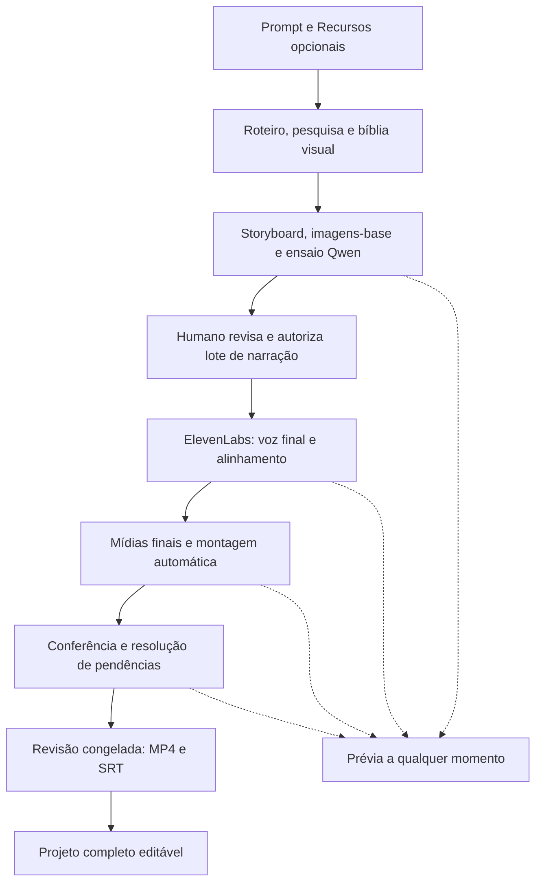

# Plano de implementação futura — vídeos horizontais

Consolidação de 2026-10-17, aguardando confirmação final de entendimento.
**Somente definição: este plano não autoriza implementar, executar provas técnicas
ou gerar conteúdo pago.** As decisões de produto foram aceitas nas Q1–Q69 da
[entrevista](planejamento-video-horizontal.md); os contratos e a sequência abaixo
organizam sua implementação futura. Capacidades ainda não demonstradas aparecem
como critérios de qualificação, sem serem tratadas como disponíveis.

## Resultado e fluxo de trabalho

Criar uma produção automática de histórias para canais darks a partir de prompt
e Recursos opcionais: planejar, pesquisar, escrever, produzir e montar, com um
editor suficiente para corrigir o resultado. Priorizar vídeos de 10–25 minutos,
sem transformar essa faixa em limite rígido e sem impor templates de narrativa
ou composição. Publicar no YouTube é uma ação separada.

A produção começa em "Nova produção", que pergunta o formato. No Horizontal, uma tela única
pede o prompt (com detecção de ideia ou roteiro fechado, corrigível), a duração e os Recursos, e
"Criar storyboard" leva direto ao Storyboard. O agente não entrevista o autor: lista as suposições
no topo do Storyboard, corrigíveis pela conversa do projeto (Q57–Q58).

A primeira entrega ao humano é o storyboard. Ele mostra a fala exata, textos na
tela, tempos estimados e esboços com ícones e descrição do que será mostrado.
“Tempo de escrita” significa duração de exibição do texto, sem impor efeito de
digitação. Imagens-base podem ser geradas nessa etapa para revisar aparência;
as mídias finais das cenas vêm depois da voz final e dos seus tempos reais.

O Qwen local permite ensaiar em PT-BR usando a referência Junior da ElevenLabs.
A entrega final usa **sempre voz da API ElevenLabs**, autorizada pelo humano no
momento escolhido. Qwen não é alternativa de voz final. O storyboard evolui no
mesmo documento até a montagem completa, preservando os ajustes humanos.

Uma ideia permite desenvolvimento criativo; um roteiro fechado preserva fala e
ordem, com reescritas propostas ao autor. Fontes ficam ligadas aos trechos, fora
do vídeo. Afirmações reais são conferidas mesmo numa história fictícia; as não
verificadas exigem correção ou “ciente” antes da entrega. Ciência não é verificação.

## Contratos do projeto e da edição

O núcleo novo usa um documento versionado, com identificadores estáveis e versão
de esquema. A implementação deverá expor um contrato validado de operações a
humanos e agentes; nenhum agente grava diretamente no documento. O desenho usa
os termos do [glossário](../GLOSSARY.md) e preserva o editor atual de Shorts.

| Parte | Contrato |
| --- | --- |
| Projeto | Revisão, versão de esquema, proporção, resolução e fps próprios; duração desejada, diretrizes e Recursos opcionais. Piloto em 1920×1080/30 fps; comportar 1080×1920 desde o modelo inicial |
| Geometria e estilo | Itens num espaço de composição próprio, que pode passar dos limites do quadro, com o quadro como enquadramento padrão (Q64). Estilo com herança explícita do template: valor ausente herda (Q65) |
| Cena | Unidade narrativa em sequência com as demais. Agrupa mídias, textos, pausas e trechos de fala inteiros; não exige uma frase ou imagem por cena |
| Faixa e item | Faixas por conteúdo: visuais sobrepostos, texto, narração, música e efeitos. Itens têm início/duração, referências de mídia, recortes, ordem visual, transformações e efeitos. Uma música pode atravessar cenas |
| Trecho de fala | Texto exato, cena, voz/modelo/configurações/dicionário, áudios e alinhamentos disponíveis. Um trecho nunca atravessa o limite de cena; juntar/dividir preserva essa regra |
| Alinhamento | Tempos e correspondência entre roteiro e fala, origem API/histórico/local, confiança, áudio de referência e revisões humanas. Guardar texto original e normalizado sem presumir índices iguais |
| Bíblia visual | Fichas de personagem, cenário e estilo; imagens-base e suas versões. Dependências permitem identificar quais mídias uma alteração afeta |
| Pedido de mídia | Prompt, referências e suas versões, proporção, duração desejada, provedor, alvo na timeline e estado. Importar pelo pedido guarda em Recursos e preenche o esboço vinculado |
| Recurso | Original e derivados identificados pelo conteúdo; metadados, origem, licença quando aplicável e referências de uso. Arquivo compartilhado não se duplica por projeto |
| Operação | Identificador, autoria, revisão/dependências esperadas, alvos e alteração delimitada. Validação, aplicação e registro de revisão/histórico formam uma ação consistente |
| Exportação | Manifesto da revisão congelada, recursos e configurações usados, MP4/SRT correspondentes e resultados de conferência. Nomes contêm a revisão |

Tempos relativos às cenas e vínculos com palavras/frases devem ser distinguíveis
dos tempos contínuos de música. O avaliador temporal calcula uma única montagem
para prévia, exportação e SRT; arredondamento de quadros ou amostras não pode
acumular deslocamento ao longo do vídeo. Pontos no tempo continuam editáveis.

As operações precisam cobrir criar/reordenar cenas, juntar/dividir fala,
inserir/substituir/cortar/dividir/mover mídias, alterar tempos/textos/efeitos,
corrigir alinhamento e aceitar/descartar propostas. Operações compostas de uma
correção permitem desfazer o conjunto; histórico e revisões são persistentes.
Desfazer/refazer edição nunca reenvia geração nem apaga consumo já ocorrido.

Cada item registra seu último autor, mas a proteção de ajustes humanos considera
as escolhas ainda vigentes no histórico. Uma alteração posterior do agente não
elimina essa proteção. Pedidos explícitos são aplicados no alcance solicitado,
com desfazer; sugestões espontâneas são propostas. “Refaça a cena” preserva os
ajustes humanos, salvo autorização explícita para substituí-los.

Edição e produção podem ocorrer juntas. Antes de enviar uma geração, conferir
as dependências: se mudaram, refazer o pedido com a versão atual. Isso não
transfere uma autorização de narração para outro texto. Um resultado já em
andamento termina e fica guardado; se ficou desatualizado ou conflita com edição
humana, entra como proposta, sem substituir a timeline. Resultados compatíveis
com suas dependências vigentes são aplicados automaticamente; uma edição sem
relação com o pedido não o transforma em proposta por mudar a revisão global.

## Componentes e reaproveitamento

Proposta técnica: manter React/TypeScript na interface e Python/FastAPI, SQLite
e FFmpeg onde atendam aos contratos. A inspeção do repositório comprova peças
reaproveitáveis, mas o preview atual por PNG/pôster e a composição dos Shorts
não demonstram um editor audiovisual multifaixa. Não se presume reaproveitamento
integral nem desempenho de vídeo longo.

| Componente lógico | Responsabilidade e fronteira |
| --- | --- |
| Núcleo de edição | Validar operações, versões e proteção humana; aplicar documento, histórico e revisão de modo consistente. Não executar chamadas remotas dentro de uma operação de edição |
| Planejamento da produção | Desenvolver roteiro, pesquisa, storyboard, bíblia visual e pedidos. Reavaliar apenas dependências afetadas, conservando os resultados válidos |
| Execução persistente | Fila, dependências, pausa, autorizações, reservas de consumo, tentativas e recuperação. Registrar cada pedido pago/com cota antes do envio |
| Adaptadores de provedor | Qualificar acesso e capacidade; enviar pedido delimitado, capturar identificadores/consumo, consultar estado/histórico e recuperar resultado quando disponível |
| Recursos compartilhados | Originais e derivados por hash fora do Git; referências entre projetos e revisões, integridade, espaço ocupado e limpeza escolhida pelo humano |
| Voz e alinhamento | Qwen de ensaio, ElevenLabs final, cache, contexto, alinhamento local, conferência e emendas. Não liberar geração paga por causa de uma correção visual |
| Montagem e renderização | Resolver tempos, efeitos, composição, prévia audiovisual, mixagem, MP4 e SRT sobre uma revisão. Motor escolhido pela prova técnica |
| Pendências e notificações | Central persistente no MyCut, bloqueios delimitados e ponte Windows para avisos emitidos pelo serviço no WSL |

Documento, histórico e pedidos persistem fora do controle de versão. A escolha
de tabelas, índices e formato de snapshots é detalhe da implementação; o contrato
exige gravação consistente e retomada, não um novo serviço distribuído. O registro
das operações deve permitir reproduzir e explicar uma revisão, com snapshots
quando necessários para evitar percorrer todo o histórico a cada leitura.

O motor de composição permanece em aberto **por decisão Q49**, até a prova técnica,
que serve também aos Shorts com motion (Q59–Q60, [ADR 0017](adr/0017-base-comum-para-shorts-com-motion-e-videos-horizontais.md)).
Os candidatos são o HTML determinístico do protótipo do MYC-9 (quadro calculado
em função do tempo e gravado num Chrome sem janela) e o Remotion. O render atual
em Python/FFmpeg entra só como referência de comparação. A prova cobre 9:16 e 16:9
e soma mola, desfoque, brilho, vidro fosco, fontes embutidas e ausência de animação
por relógio aos critérios de 25 min, NVENC e mixagem. Mesma composição em código não
basta para declarar equivalência entre players e caminhos de exportação. Licença e
distribuição também são critérios de escolha. Nenhum candidato foi adotado.

## Voz, sincronismo e alterações

Toda geração ElevenLabs solicita tempos por caractere. Usar contexto textual
vizinho e encadeamento quando a combinação de rota/modelo oferecer esses recursos.
Se faltarem tempos válidos, tentar recuperá-los e então alinhar localmente o mesmo
áudio. O alinhador local atende também ao WAV do Qwen, que hoje não fornece tempos.
Registrar a origem e qualificar a correspondência entre texto original/normalizado.

A conferência mostra forma de onda e marcas de palavras; o humano ajusta por
palavra ou frase. Baixa confiança gera pendência resolvível por escuta/conferência
explícita ou ajuste, com autor e versão registrados. Alinhamento ausente ou
estruturalmente inválido precisa ser corrigido. A correção manual fica vinculada
àquele áudio e é protegida; regenerar o áudio sinaliza sua invalidação para a
nova versão e preserva o histórico anterior.

O cache identifica texto exato, voz, modelo, configurações e dicionário de
pronúncia, guardando também o contexto da geração. Voltar à combinação anterior
reutiliza o áudio da API. Contexto vizinho diferente pode exigir conferir a emenda,
sem invalidar automaticamente o arquivo nem gerar voz paga. No ensaio, a timeline
usa a duração do Qwen; a voz final passa a determinar os tempos quando chegar.

Juntar/dividir fala reaproveita áudio quando texto e ordem continuam válidos:
cortes em pausas/fins de frase pelo alinhamento, transição curta e conferência de
estalos e respirações cortadas. Entonação inadequada gera sugestão de regenerar,
sujeita à autorização do lote correspondente.

| Alteração | Comportamento esperado |
| --- | --- |
| Fala cresce ou encurta | Ajustar cena, deslocar seguintes em conjunto e realinhar os conteúdos ligados à fala; nenhuma lacuna involuntária |
| Mídia não cobre o novo tempo | Tentar velocidade, congelamento, zoom/panorâmica ou mídia adicional que sirva ao trecho, dentro dos limites e da proteção humana; só então declarar pendência |
| Música atravessa cenas | Continuar ou cortar com fade; não esticar a música para acompanhar a fala |
| Texto muda de sentido | Rever mídias, fontes e fichas/imagens-base afetadas, mesmo se a duração não mudar; invalidar a ciência anterior de afirmações alteradas. Refazer mídia do agente não ajustada dentro dos limites; mídia ajustada vira proposta/pendência |
| Grafia/palavra muda sem alterar sentido | Não disparar revisão semântica. Reavaliar voz e tempo; pontuação e grafia fazem parte da autorização exata de narração |
| Só o visual muda | Não pedir nova voz |

## Consumo, retomada e autonomia

A autorização de narração identifica um lote específico, versões exatas, voz,
modelo, configurações, dicionário, alcance e custo apresentado. Pode abranger
várias chamadas; falhar um trecho não revoga os demais. Não serve para lotes
futuros. Novos envios param se ultrapassarem o valor autorizado e exigem nova
autorização; chamadas já enviadas podem concluir e têm seu consumo registrado.

O executor deve considerar estimativa/reserva dos pedidos em andamento antes de
liberar novos, para que concorrência não gaste várias vezes o saldo disponível.
Se o provedor informar custo apenas depois, registrar a diferença e suspender
novos envios afetados; uma autorização local não cria um teto remoto garantido.
Mostrar estimativa, consumo confirmado, valores ainda incertos e saldo por unidade.

| Limite/estado | Regra |
| --- | --- |
| Qualidade de mídia | Uma geração inicial + duas novas, somadas entre provedores. Humano pode liberar mais para uma mídia explicitamente, sem aumentar automaticamente o teto da produção |
| Falha técnica confirmada sem resultado | Três tentativas totais com intervalos crescentes, separadas das tentativas de qualidade e ainda sujeitas a autorização/tetos |
| Resultado desconhecido | Consultar provedor/histórico e recuperar antes de considerar reenvio. Se continuar incerto, pedir decisão humana; timeout não prova ausência de resultado |
| Teto por produção/provedor | Configurável e finito na unidade do provedor: caracteres/créditos ElevenLabs, gerações Grok/Gemini. Não somar unidades incompatíveis. Atingir teto bloqueia só envios desse provedor |
| Troca visual de provedor | Ordem configurável; somente acesso confirmado. Não zera tentativas nem desvia silenciosamente pedidos bloqueados por teto. Preferir mesmo provedor para personagem/cenário dentro da cena; troca exige conferência visual |
| Pausa | Impede novos envios; edições e prévia continuam. Acompanhar o já enviado e guardar resultados |
| Computador desligado | Serviço para; retomada segue registro e consulta ao provedor. Contadores e autorizações não são reiniciados |

Todo pedido pago ou com cota registra o que será enviado antes do envio, incluindo
dependências, autorização aplicável e identificador local; acrescenta IDs remotos
quando recebidos. A retomada reconcilia pedidos incertos antes de repetir efeitos.
O adaptador precisa controlar a unidade real de geração: um CLI que esconda
chamadas internas não demonstra o registro/limite por pedido. Qualificar esse
controle; se indisponível, usar o pedido manual ligado a Recursos, sem afirmar
automação auditável que não foi comprovada.

Grok/Gemini significam ferramentas instaladas localmente acionando plataformas
remotas com os acessos existentes. Não se aprovou contratar outra API paga de
vídeo. Quando a automação não funcionar, entregar prompt/referências/duração/
proporção para gerar na plataforma e importar pelo pedido correspondente.

Pendência de um clipe, teto de um provedor e pausa da produção são estados
distintos. Trabalho independente continua onde permitido. A central do MyCut
preserva pendências; uma ponte no Windows emite aviso com a janela fechada,
uma vez por pendência nova e em resumo por produção para ocorrências simultâneas.
Se notificações estiverem bloqueadas, indicar isso na interface. PowerShell toast
é uma possibilidade a qualificar, não uma ponte já existente.

## Editor, mixagem e entrega

O editor inclui editar fala/textos, trocar mídias, cortar/dividir/mover trechos,
duração, posição, tamanho, camadas, volumes, transições e desfazer/refazer.
Inclui corte/fusão/fade, zoom/panorâmica, posição/escala/rotação/opacidade com
pontos no tempo, entrada/saída de textos, brilho/contraste/saturação/desfoque,
velocidade e congelamento. Máscaras, chroma key e LUTs ficam fora desta versão.

Áudio dos clipes fica desligado por padrão e a narração final é ElevenLabs.
Música/efeitos vêm de Recursos ou biblioteca de licença conhecida; baixar da
internet ou usar serviço pago exige autorização. Diminuir música na fala; como
ponto de partida ajustável, mantê-la 15–20 LU abaixo da voz durante a fala.

A mixagem tem alvo de −14 LUFS integrado, tolerância ±1 LU, pico verdadeiro de
no máximo −1 dBTP e 48 kHz, medidos no arquivo final decodificado. Usar duas
passagens, medindo e aplicando em modo linear. O FFmpeg pode usar modo dinâmico
quando as condições lineares não são atendidas; portanto conferir o modo
efetivo, além das métricas finais. Se incompatível, revisar a mixagem e sinalizar
pendência, sem aceitar silenciosamente normalização dinâmica. Não requer nova
geração paga de voz. A [pesquisa documental](planejamento-video-horizontal.md#mixagem)
registra fontes e condições do filtro. Conferir também inteligibilidade, emendas,
respirações e ausência de oscilação incômoda da música.

A prévia, em 720p ou menos, pode conter esboços e voz de ensaio a qualquer momento.
O ensaio de escala pode renderizar artefatos de teste com Qwen; esses arquivos
são identificados como teste e não satisfazem o contrato de entrega final.

Para a primeira entrega automática, a revisão deve conter voz final válida para
todos os trechos, mídias previstas resolvidas, alinhamento válido/conferido,
afirmações verificadas ou com ciência humana e montagem consistente. Congelar
essa revisão, renderizar e medir a saída; somente marcar a entrega concluída
após aprovação das verificações técnicas. Uma medição que falhe mantém a entrega
pendente, mesmo que um arquivo intermediário já tenha sido produzido.

Entregar MP4 H.264/AAC 48 kHz e SRT da narração final, sempre da mesma revisão,
incluída nos nomes. Legenda gravada na imagem fica desligada por padrão, ativável
no projeto ou prompt. Editar durante exportação é permitido; o arquivo anterior
não representa a revisão nova. Reexportações após correções são solicitadas pelo
autor. Exportações anteriores permanecem até exclusão explícita.

Originais, áudios, alinhamentos, projetos, histórico e exportações ficam fora do
Git público. Deduplicar arquivos por conteúdo entre projetos e considerar
referências de revisões/entregas antes de apagar. A interface mostra espaço por
projeto e distingue conteúdo compartilhado de espaço efetivamente liberável.
Derivado regenerável não significa permissão para limpeza automática.

## Conversa com o agente e contexto

Decisões Q51–Q56 e [ADR 0016](adr/0016-contexto-dos-agentes-no-mycut-e-passagem-continua.md).
O Storyboard e a Montagem oferecem conversa com o alcance visível (item, trecho de
fala, cena, sequência ou projeto). As conversas ficam guardadas por alvo. No Storyboard,
"Conversar sobre esta cena" e "Conversar sobre o projeto" abrem um modal próprio
daquela conversa, separado das demais. As cenas aparecem como cartões de largura e
altura iguais, lado a lado, quebrando linha quando falta espaço, e a última linha
fica alinhada à esquerda. Pedidos explícitos e propostas seguem a ADR 0009; um pedido de versões gera várias propostas, aplicadas só na escolha (ADR 0017), e nenhuma conversa libera
geração paga de narração.

| Parte | Contrato |
| --- | --- |
| Memória | No SQLite local do projeto, fora do Git: conversas, mensagens, resumo versionado e notas de passagem. CLIs efêmeros, sem estado de sessão |
| Pacote de contexto | Estado atual do alcance, fichas relevantes, regras de proteção, resumo, mensagens recentes e notas do alvo, com tamanho controlado. Projeto inteiro recebe roteiro e mapa de cenas. Cada pacote enviado fica no acervo por conteúdo, referenciado pelo pedido registrado |
| Passagem contínua | Depois de cada resposta, atualizar o resumo e gravar a nota de passagem ligada às operações e ao alvo. Troca de papel ou de provedor, reabertura da página e retomada após falha usam o mesmo mecanismo. Resposta interrompida fica marcada, sem apagar o último estado |
| Limite do CLI | Avisar pela central e por notificação e oferecer o outro provedor, sem troca automática. Etapas automáticas pausam só o papel afetado |

## Canal

Decisões Q67–Q69 e [ADR 0018](adr/0018-canal-como-dono-dos-padroes-e-das-orientacoes.md).
Cada projeto pertence a um canal, que guarda nome e marca, template padrão de cada formato,
voz e configurações padrão e orientações do canal. O canal (MYC-33) é o primeiro card a ser
executado, antes da fase 0. Os Shorts existentes vão para um canal padrão sem mudar o resultado.
As orientações aprendem só com o que o autor aceita e descarta (MYC-30), e um card próprio (MYC-34)
propõe orientações a partir dos ajustes que o autor refaz.

## Fases futuras e evidência de saída

As fases descrevem trabalho a executar apenas após um pedido posterior de
implementação. Qualificações que precisem de geração real continuam respeitando
autorização e custo; não foram executadas durante esta definição.

| Fase | Entrega | Evidência para avançar |
| --- | --- | --- |
| 0 — Qualificação técnica | Montagem pequena representativa nos candidatos de motor; avaliação de licença, mídia/fontes, reprodução, render, ponte Windows e adaptadores. Ensaio de escala de 25 min com Qwen e mídia barata/esboços, sem ElevenLabs | Comparação prévia/exportação, teste real de encode NVENC no WSL, tempos/memória/resposta, condições de licença e notificação com janela fechada. Registrar limitações e escolher motor com evidência |
| 1 — Núcleo e persistência | Documento, operações, revisões, histórico, proteção humana, recursos por conteúdo e dados fora do Git | Edição/undo/redo e reinício preservam estado; concorrência não sobrescreve ajustes; compartilhamento e limpeza mantêm referências. Shorts existentes seguem intocados |
| 2 — Storyboard executável | Prompt/Recursos, roteiro/pesquisa, bíblia visual, imagens-base, esboços, Qwen, alinhamento local e prévia inicial no motor escolhido | Revisar fala/aparência/tempos no mesmo projeto; alinhar e corrigir por palavra/frase; mudanças revisam dependências sem produzir mídias finais antecipadamente |
| 3 — Produção controlada | Executor persistente, lotes/autorização, limites, ElevenLabs com cache/alinhamento/contexto, adaptadores visuais e importação vinculada | Uma produção curta percorre o fluxo real, com gasto autorizado; consulta/retomada, atualizações antes do envio, resultados desatualizados e contagem por provedor demonstrados. Ao menos um provedor visual automático qualificado |
| 4 — Montagem e editor completos no escopo | Todas as operações/efeitos aceitos, reajuste da montagem, mixagem, pendências, notificações e exportação MP4/SRT por revisão | Equivalência entre prévia e entrega com os efeitos integrados; métricas de áudio/sincronia; proteção humana, revisão congelada e retenção dos arquivos |
| 5 — Piloto horizontal | História original de cerca de 15 min completa, exercício da alternativa manual e dos cenários de falha; repetir escala 25 min sobre o caminho integrado | Matriz abaixo preenchida com evidências, consumo e limitações. Corrigir falhas antes de declarar piloto aprovado |
| 6 — Motion nos Shorts (MYC-9) | Sobre a base comum: mapa e câmera, templates, pedido de versões com ousadia, objeto livre e orientações do canal; depois o Short livre migra, com conversão opcional por projeto (ADR 0017) | Ponta a ponta do Short do Argon aceito; projeto convertido validado separadamente; original e editor antigo preservados, sem migração automática |

## Matriz de aceitação do piloto

| Área | Evidência exigida |
| --- | --- |
| História de aproximadamente 15 min | Storyboard revisável, voz final autorizada, composição livre, continuidade de personagem/cenário, pelo menos um clipe gerado automaticamente com acesso confirmado e pedido manual importado no lugar correto |
| Ensaio de 25 min | Qwen + mídias baratas/esboços, sem gasto ElevenLabs; medir tempo total de exportação, etapas relevantes, pico de memória e resposta de reprodução/busca. Identificar o artefato como teste |
| Renderização | Mesmo motor ou equivalência demonstrada de conteúdo, geometria, fontes, cortes, efeitos, velocidade/congelamento, tempos e mixagem. Considerar resolução reduzida e perdas do codec ao comparar; compartilhar código não basta |
| NVENC no WSL | Encode real na RTX 5070 Ti com verificação do caminho usado e tempo de exportação de 25 min. `nvidia-smi` ou lista de encoders não comprovam encode; encode por GPU não comprova aceleração de toda a composição |
| Mixagem | Arquivo final decodificado: −14 LUFS ±1 LU, ≤−1 dBTP, 48 kHz; comprovar segunda passagem linear e conferir música/fala/emendas auditivamente |
| Sincronismo | Texto/legenda ligados à fala em torno de ±100 ms da palavra; avaliar também inícios, finais, cortes, emendas e trechos após reajustes. Registrar palavras conferidas e desvios; amostragem declarada não é prova de todas as palavras |
| Alinhamento manual | Forma de onda, ajuste por palavra/frase, autoria/proteção; novo áudio sinaliza invalidação da correção anterior. Baixa confiança e ausência de tempos seguem resoluções distintas |
| Alterar e desfazer fala | Ensaio troca para Qwen, chegada de voz final reajusta montagem, desfazer recupera áudio anterior válido; sem nova chamada paga por simples reuso |
| Crescer/encurtar cena | Deslocar seguintes e realinhar vínculos sem buracos; música não estica; adaptação de mídia preserva intenção e ajustes humanos |
| Edição concorrente | Mudança antes do envio atualiza pedido sem herdar autorização inválida. Durante geração, resultados incompatíveis ficam como proposta e compatíveis entram automaticamente. Aceite/descarte e undo não repetem gasto |
| Retomada | Interromper deliberadamente o serviço durante geração autorizada. Ao reiniciar, recuperar/consultar antes de reenviar; dúvida remanescente pede decisão. Contadores e resultados sobrevivem |
| Consumo e limites | Comparar estimado/real por provedor e produção na unidade própria, explicando desvios e incertezas. Exercitar 1+2 compartilhado, três tentativas técnicas, teto localizado e autorização de lote sem reutilização futura |
| Continuidade visual | Troca de rosto/roupa/lugar/estilo detectada e tratada; alteração de ficha alcança imagens-base; troca de provedor obriga conferir mídia; ajuste humano não é substituído sozinho |
| Pausa e notificações | Pausa mantém editor/prévia; serviço com janela fechada entrega aviso Windows via ponte, um por pendência nova e agrupamento simultâneo por produção. Reabertura conserva a central de pendências |
| Entrega | MP4/SRT da mesma revisão nos nomes; edição durante exportação não altera o snapshot. Pendências bloqueantes impedem entrega final, mas permitem prévia. Exportações antigas permanecem |
| Recursos e Git | Mesmo arquivo em projetos diferentes compartilha conteúdo; originais/histórico/áudios/exportações fora do Git. Espaço mostrado e limpeza explícita não removem referências necessárias silenciosamente |
| Conversa e passagem | Conversa sobre uma cena no Storyboard e sobre um item na Montagem. Trocar Codex por Claude no meio da conversa e fechar/reabrir a página mantêm o assunto. O pacote enviado fica registrado, e o limite de uso do CLI gera aviso e oferta de troca, sem troca automática |

Não foi fixado um tempo máximo de exportação, memória máxima ou latência da prévia
sem medição. A fase 0 deve produzir esses números e explicitar a viabilidade e
as limitações no hardware alvo; os números de áudio e sincronismo acima já são
critérios aceitos. Licenças, acesso real aos provedores, controle das chamadas
dos CLIs, rota/modelo ElevenLabs e qualidade do alinhador PT-BR também dependem
de qualificação. O plano não declara esses pontos aprovados por documentação.

## Referências das decisões

- [Entrevista, estado atual e fontes primárias](planejamento-video-horizontal.md).
- [ADR 0006 — Faixas e cenas](adr/0006-faixas-de-conteudo-e-agrupamento-por-cena.md).
- [ADR 0007 — Autorização de narração](adr/0007-autorizacao-humana-para-gerar-narracao.md).
- [ADR 0008 — Storyboard primeiro](adr/0008-storyboard-antes-da-producao-de-midias.md).
- [ADR 0009 — Correções e proteção humana](adr/0009-pedidos-de-correcao-com-aplicacao-direta.md).
- [ADR 0010 — Ensaio e voz final](adr/0010-audio-de-ensaio-local-e-narracao-final.md).
- [ADR 0011 — Clipes automáticos e importação](adr/0011-geracao-de-clipes-e-alternativa-manual.md).
- [ADR 0012 — Reajuste da montagem](adr/0012-reajuste-da-montagem-apos-mudancas-na-fala.md).
- [ADR 0013 — Pedidos registrados e versões](adr/0013-pedidos-registrados-e-resultados-vinculados-a-versoes.md).
- [ADR 0014 — Documento e operações](adr/0014-documento-de-edicao-e-operacoes-compartilhadas.md).
- [ADR 0015 — Recursos por conteúdo](adr/0015-recursos-por-conteudo-fora-do-git.md).
- [ADR 0016 — Contexto dos agentes e passagem contínua](adr/0016-contexto-dos-agentes-no-mycut-e-passagem-continua.md).
- [ADR 0017 — Base comum com os Shorts com motion](adr/0017-base-comum-para-shorts-com-motion-e-videos-horizontais.md).
- [ADR 0018 — Canal](adr/0018-canal-como-dono-dos-padroes-e-das-orientacoes.md).
